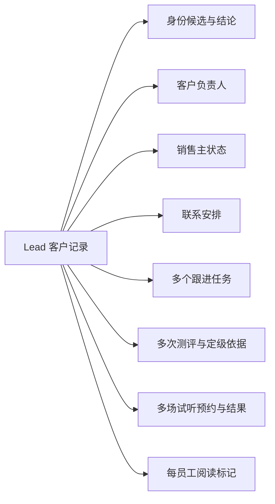

# 客户状态与操作规则设计

版本：0.1设计稿（部分交互已实施）。最后更新：2026-10-22 10:49:04-07:00（America/Vancouver）。语言：中文，术语附英文。

阅读方式：正文用业务语言说明“客户现在是什么情况、谁能处理、需要什么条件、处理后怎样”。客户记录称Lead，客户负责人称Owner；CRM管理者和销售分别对应CRM Manager和Sales。研发字段只供对照，历史日志保留当时原文。

状态：完整客户状态设计仍待确认；7.3／7.4的交互与7.5配置已实现并有本地定向验收。P0动作约束已按[独立方案](./P0-ACTION-GATES-PLAN.md)实施并完成本地定向验收（范围与未覆盖项以报告为准），结果见[验收报告](./P0-ACTION-GATES-ACCEPTANCE.md)。其余客户状态设计、迁移及V系列验收均为后续提案，不因文档更新生效。现有账号、授权范围、客户归属、任务期限、HSK题库与评分规则保持不变。

相关基线：[CRM业务需求与系统需求](./CRM-REQUIREMENTS.md)。读者：运营负责人、CRM管理者、销售与研发。本文作为设计参考，不代替在线操作指南。

## 1. 设计结论与边界

每条客户记录由多个独立维度共同描述。销售推进、身份核实、客户归属、联系安排、任务、测评、试听、客户分组和阅读状态分别有各自的数据来源。

**测评完成与试听预约／试听完成是独立属性。不存在“先完成测评才能预约试听”的通用规则，也不存在测评状态向试听状态迁移。** 同一客户可以没有测评但已经试听，可以完成测评却没有试听，也可以多次测评并有多次不同试听。

客户记录上的“已完成测评”“已预约试听”是依据具体记录计算的页面摘要。每次测评或每场试听可以有自己的每场业务从安排到结束的变化，例如一场试听从已预约变为已取消；这不会自动改写测评或销售主状态。

本方案建议：销售主状态描述商业关系进展；任务描述需要做的工作；测评、试听与报名依据描述已经发生的事实。不要用一个只能选一个值的下拉框承载这三类信息。

### 1.1 标记约定

- **现有**：当前工作区代码存在，部分关键路径已有本地验收；不代表本轮重新测试全部组合。
- **缺口**：源码可定位的缺少或不一致；未经运行复现的边界不称为已复现BUG。
- **提案**：需要用户确认后才实施的目标规则。
- 历史未知：缺少可靠证据或时间时保持未知，不用当前值倒推历史。

### 1.2 本轮不做

不修改R1～R6分类优先级、HSK评分或试卷；不做物理合并；不推断客户已接通、到场、付款或报名；不补造旧事件；不重放历史通知；不新增团队权限；不遮蔽号码；不引入AI自动销售决策。

## 2. 现在已经实现的功能核对

| 编号 | 现有实现 | 缺口／边界 | 核对依据 |
|---|---|---|---|
| C01 | 销售阶段字段保存8个只能选一个的值：尚未建联、已建联、测评已预约、测评已完成、试听已预约、试听已完成、已报名、已流失 | 将销售进展、测评和试听混在同一字段；不能同时表达“已测评且已约试听” | crmLead.ts、trustRoutes.ts |
| C02 | 阶段更新校验权限、合法值、原因、原状态与版本 | 未统一校验相邻迁移与业务证据，能够人工跨阶段选择 | stageFact、stage接口、客户记录 PATCH |
| C03 | 有效非空联系方式匹配生成身份候选；默认CRM管理者核实；角色开关关闭时仍要求销售具有双方原权限；销售待核实时不能认领／主动联系 | 关系判断不等于同一人的历史汇总；无统一重审、证据不足复查或关系撤销流程 | identityReview.ts、trustRoutes.ts |
| C04 | 认领在事务中检查最新客户负责人、身份候选、权限；多人同时认领只能一人成功 | 分配、转交和普通清空Owner均要求先核实；停用交接仅授权Manager可明确退回共享池，不能借此认领 | runtime.ts、CrmWorkbench.tsx |
| C05 | 电话／WhatsApp／复制共用用途及最新权限检查；停止禁止；普通管理者协助自动留痕，无额外原因必填 | 明确日期约定前禁止普通外联；旧等待／培育先核对。身份核实、客户新问题回复均要求相应依据，不能绕过停止限制 | crmOutreach.ts、contact-authorization |
| C06 | 每个任务独立保存未完成/逾期/已完成/已取消，历史中另有待确认任务；保留原截止及改约时间 | 任务创建、补充、替代的目的判定未完全统一；不能把所有同类任务都当重复 | trustWorkflow.ts、salesWorkflow.ts |
| C07 | 明确人工／预约／报名请求复用同类开放任务并追加来源依据 | 普通手工跟进任务的创建路径尚无统一的业务目的去重／冲突处理 | ensureFollowup、saveSalesWorkflow |
| C08 | 保存联系记录只完成选定任务，保留其他任务；仅保存记录不完成任务或改联系安排 | 活跃但无后续安排仍可仅记录事实，需在工作队列持续显式提示；不能说每次保存都已安排好后续工作 | salesWorkflow.ts |
| C09 | 新安排采用复查任务与可选日期限制，停止独立保留；检查版本并保留变更审计 | 旧等待／培育记录不批量改写；缺少依据不自动恢复；本轮未重构完整Lead状态维度 | salesWorkflow.ts、worker.ts |
| C10 | 连续未回复有计数中/最后等待/已转培育/人工分组受保护/已回复/需核查；使用原有策略、间隔、最终等待窗口，人工分组受保护 | 不能将未回复后的最后等待时间与员工设置的暂停安排混用；不能只看到第3次记录就立即认定已进入培育 | crmNoResponse.ts、noResponse.ts |
| C11 | 完成测评保存独立测评记录及结果／事件，不自动写销售阶段字段 | 测评已完成旧阶段不能替代真实测评记录；自报、快速／完整测评及教师定级须分开 | assessments.ts |
| C12 | 每员工有独立阅读标记；任务和未读独立；轻量变更检查用于刷新 | 所有影响动作权限的新状态／身份关系变更需纳入刷新版本；仅UI缓存不是授权依据 | leadChanges.ts、lead_read_marks |
| C13 | 来源待核实→已关联/已标记无效；创建活动与关联已有活动最终均是已关联 | 这是营销来源核实，不是身份核实，不应阻止正常销售联系 | campaignSources.ts |
| C14 | 通知事件、作业、站内阅读分开；任务过期由后台时钟处理 | 通知接受不证明实收；作业状态不决定客户记录销售状态；旧记录不得自动补发 | worker.ts、notificationDelivery.ts |

上述是2026-10-22源码核对，不是新的全量环境验收结论。已验收的本地样例不构成所有旧数据迁移已完成的证据。

## 3. 目标客户状态设计（提案）

### 3.1 客户有哪些独立情况，各自依据什么记录

| 维度 | 目标值／对象 | 以哪些记录为准 | 自动计算还是人工维护 |
|---|---|---|---|
| 身份核实 | 无有效候选、身份待核实；候选关系结论同一人/不同人/共用联系方式 | 身份候选、结论及证据 | 系统发现；CRM管理者判断；一条关系的结论不覆盖其他未核实关系 |
| 客户归属 | 未分配或明确的有效负责人 | 客户记录归属及归属审计 | 销售明确认领；CRM管理者分配、转移或退回共享池 |
| 销售进展 | 尚未建联、已建联、已报名、已流失；历史证据不足保留尚未确认的情况 | 主状态、销售事实及变更记录 | 人工确认；系统可提示建议，不静默推进 |
| 联系限制与复查任务 | 明确日期前不主动联系、停止主动联系；无约定沿用正常权限 | 任务、原因、约定时间及版本 | 日期限制到期结束，任务待处理；停止须明确恢复，不自动发送 |
| 工作任务 | 多个独立任务；未完成、逾期、已完成、已取消；历史待确认仅兼容历史 | 每条任务的ID、状态、动作、目的、期限与版本 | 事件或人工创建；时钟逾期；员工明确处理 |
| 测评情况 | 是否有可归属的已完成测评、完成次数、最近结果、依据类型；无记录与未知区分 | 独立测评／定级依据，不是销售阶段字段 | 根据已保存记录显示；不重新评分 |
| 试听情况 | 是否有未来有效预约、是否有已确认完成试听、最近试听、次数 | 每场试听记录及人工确认依据 | 根据预约和试听记录显示；不依赖测评是否完成 |
| 连续未回复情况 | 计数中、最后等待、已转培育、人工分组受保护、已回复、需核查及计数 | 可信人工记录、客户新消息、这轮开始时保存的策略 | 现有规则和后台时间处理 |
| 客户分组 | 保留现行分组及人工确认／预测来源 | 现行分类评估与人工确认记录 | 仅原有触发路径；算法本轮不改 |
| 阅读情况 | 每员工已读／未读 | 员工已读位置及真实新动态 | 查看行为；与业务完成独立 |
| 活动来源 | 原始码、已识别、待核实、已关联、已标记无效 | 原始来源与核实审计 | 原有来源流程；不与身份状态联动 |

不另存一个“已读且已测评且未认领”的组合状态。页面组合展示各维度，下一步动作按约束推导。

### 3.2 关系与业务记录

图中为对象关联，不表示顺序。测评和试听之间没有迁移箭头。客户记录仍保留原ID，跨客户记录同人关系不自动改写聊天、测评归属或客户负责人。

### 3.3 测评与试听的具体语义

- “有已完成测评”来自至少一条可归属的完成记录；保存完成状态不表示通过某个HSK等级，更不表示官方认证。
- 快速测评、完整测评、教师定级、自报分别列明；教师定级不冒充做过试卷，自报不算已完成测评。
- 现有服务端主要保存已完成的测评记录。不能仅因没有完成记录就断言“从未开始测评”；未保存的浏览器草稿不是服务端进度事实。
- 一人可以有多个测评记录。新增失败或未完成尝试不抹去已有有效成绩；当前有效结果与最近活动分别说明来源及时间。
- 一场试听建议有独立trialId、预约时间、形式、负责人、业务目的、状态、结果依据。当前通用booking任务不一定已有完整试听实体，属于待完善项。
- 每场试听可按`booked → completed / cancelled / no_show`变化；`no_show`必须由员工按事实确认，不能仅凭时间已过判断。改期保存变更记录，不删除原约定时间。
- 曾完成一次试听、又预约另一场试听时，两个摘要可以同时为真。取消未来一场试听，不抹去历史已完成试听。
- 营销活动确认到场不等于试听出席；没有试听关联依据不能自动计入试听完成。

## 4. 角色与操作权限（提案，现有授权范围为上限）

以下表格属于完整客户状态设计目标，不代表全部已实现。核实角色和客户负责人资格须结合7.5已实现的三个配置。P0动作矩阵已单独批准并实施，以独立P0方案及验收报告为准；其余目标未经批准不改变现状。

角色名称不直接代替有效权限。每次操作仍检查账号有效性、业务授权及记录范围；不新增团队权限。

| 操作 | 普通销售 | CRM管理者 | 兼任CRM管理者＋销售 | 仅系统管理员 | 客户／后台 |
|---|---|---|---|---|---|
| 查看客户记录 | 现有可读范围 | 现有可读范围 | 权限并集，不超已有范围 | 无CRM授权不得查看 | 客户仅本人会话数据 |
| 认领未分配客户记录 | 有claim/own/followup资格且无身份待核实 | 单独CRM管理者不自动获得认领资格 | 与销售相同条件，显示认领按钮 | 不可 | 不可自动替人认领 |
| 分配／转移客户负责人 | 不可把本人客户转给其他销售 | 有assign权限；目标为有效可跟进员工 | 同CRM管理者 | 无CRM授权不可 | 不可 |
| 核实身份 | 不可 | 双方可访问且有核实权限 | 同CRM管理者 | 不可仅凭系统管理角色核实 | 系统只发现候选 |
| 主动联系 | 本人且有followup权限，并通过身份／联系安排检查 | 现有范围内可直接协助，普通协助不要求事前原因；特殊联系按规则检查 | 自有客户走客户负责人规则，代处理走CRM管理者规则 | 无CRM授权不可 | AI回复不算人工联系 |
| 保存联系事实 | 本人授权范围；保留真实发生的事实 | 现有授权范围，可代处理留痕 | 同上 | 无CRM授权不可 | 客户消息保存为客户发来的消息事实 |
| 修改主状态／试听业务结果 | 本人授权范围，满足证据与版本条件 | 现有授权范围 | 同上 | 无CRM授权不可 | 系统仅提出建议 |
| 设置／结束日期约定、停止／恢复联系 | 当前授权范围内，原因必填 | 当前授权范围内，原因必填 | 同上 | 无CRM授权不可 | 日期限制到期自然结束，不自动联系；停止须明确恢复 |
| 完成／取消／替代任务 | 授权范围，明确任务ID与处理结果 | 授权范围 | 同上 | 无CRM授权不可 | 后台只对符合规则的任务标逾期 |
| 取消已核实身份结论／历史业务纠错 | 不开放通用覆盖入口 | 独立的有理由纠错流程，保留旧结论 | 同CRM管理者 | 无CRM授权不可 | 不自动重写 |

CRM管理者无权查看某个候选的另一条记录时，不展示对方受限资料、不允许单侧强行确认；交由具有双方权限的CRM管理者处理。保留当前可见的待核实标记，不能因候选细节不可见就解锁销售主动联系。

## 5. 什么事情会改变客户情况（提案）

以下每项只改变明确选中的内容，不顺带修改客户其他情况。要改其他内容，必须另行操作并留下记录。

### 5.1 身份与归属

| ID／触发 | 原状态→结果 | 条件／操作者 | 一起保存的内容及其他影响 | 不得顺带发生 |
|---|---|---|---|---|
| E01 登记／咨询保存 | 无客户记录→新客户记录 | 客户有效输入、访客归属明确 | 保存原来源；初始客户负责人未分配、主状态尚未建联；按现行规则创建首次任务 | 不凭姓名合并、不借用他人测评 |
| E02 有效联系方式匹配 | 未发现关联→身份待核实 | 非空合法且规范化相同；系统 | 建立候选与依据；双方都显示身份待核实；CRM管理者队列可见 | 不自动决定同人、不转移客户负责人、不改任务期限 |
| E03 身份核实 | 某一对记录身份待核实→同一人/不同人/共用联系方式 | CRM管理者双方授权、证据与版本有效 | 记录前后结论、操作者、时间和依据；重新计算全部待核实关系 | 不物理合并；还有其他身份待核实关系时不解锁认领 |
| E04 证据不足 | 继续保持身份待核实 | CRM管理者说明尚缺证据及复查安排 | 提案增加复查记录和内部任务；不为了允许后续操作而随意选“不同人” | 不清空候选或解除保护 |
| E05 重审／纠错 | 已核实关系→重审记录 | CRM管理者明确理由和影响确认 | 保留原结论，新增纠错版本；重新计算待核实限制 | 不删除原证据；不自动撤销已经发生的合法联系 |
| E06 销售认领 | 未分配→当前员工 | 资格有效、无待核实身份、保存时锁定并重新检查负责人 | 写客户负责人及归属审计；按现行规则同步开放任务客户负责人 | 不重置响应时限、不完成任务、不改销售主状态 |
| E07 分配／转移 | 客户负责人 A或未分配→客户负责人 B | CRM管理者有分配权限；目标员工可处理该客户记录；无待核实身份 | 写客户负责人和原因；重新检查任务／通知路由 | 不删除历史联系、不继承转移者阅读状态 |
| E08 退回共享池 | 已分配→未分配 | CRM管理者、原因、未完成事项预览 | 保留任务，内部事项按原有CRM管理者兜底路由 | 不清空截止时间、不视作客户关闭 |

E07先核实再分配的约束已在本轮P0统一实现。若待核实期间需指定调查负责人，建议记录“核实任务负责人”，保持客户负责人不变；不以分配客户负责人替代核实。

### 5.2 销售主状态（与测评、试听属性独立）

目标先复用4个已有商业含义值，不在本轮引入Qualified等新阶段。尚未建联现文案“待初访”容易与已尝试但未回复冲突，后续建议统一解释为“尚未建立有效双向沟通”，文案调整另行三语验收。

| ID／迁移 | 触发与最小证据 | 允许角色／约束 | 明确不自动改变 |
|---|---|---|---|
| L01 初始→尚未建联 | 新客户记录登记 | 现有登记流程 | 不宣称已联系 |
| L02 尚未建联→已建联 | 已发生人工双向交流；原始人工记录或明确确认依据 | 客户负责人授权或CRM管理者；员工确认，不从AI回复自动判断 | 测评、试听、付款、任务完成 |
| L03 尚未建联/已建联→已报名 | 明确报名确认依据、操作者和记录时间；可关联已有报名事实 | 客户负责人授权或CRM管理者；跳过沟通阶段必须保留报名依据 | 不推断已付款，不自动完成其他任务 |
| L04 尚未建联/已建联→已流失 | 明确流失原因，人工确认 | 客户负责人授权或CRM管理者；未回复不能单独自动流失 | 不自动设置停止联系或取消任务 |
| L05 已流失→已建联/尚未建联 | 明确新需求或重新沟通依据，人工重开 | 当前客户负责人或CRM管理者；联系安排若停止联系须单独恢复 | 不删除流失历史，不重设旧响应时限 |
| L06 已报名纠错 | 有误登记的证据、目标状态及理由 | CRM管理者纠错流程 | 不删除原报名记录或假造退款 |
| L07 已建联→尚未建联纠错 | 原“已建联”是误记，说明依据 | 当前客户负责人或CRM管理者，保留历史 | 未回复不能自动退回尚未建联 |

已报名客户出现新咨询，保留报名历史，正常接收消息并安排独立任务；不能为新课程机会覆盖已报名事实。独立商机（Opportunity）与退款／退课流程不属于本方案已实现范围。

系统可根据可靠新事实提示“建议更新销售主状态”，员工确认后才提交。测评完成、试听预约、试听完成均不构成L02/L03的隐式迁移，也不要求按这些活动的时间顺序推进主状态。

### 5.3 测评和试听业务记录

| ID／触发 | 写入／摘要变化 | 条件 | 不得发生 |
|---|---|---|---|
| A01 完成测评 | 保存测评记录与结果；hasCompletedAssessment=true，更新可解释的摘要 | 访客／客户记录归属正确、有效提交、现有评分器 | 不改HSK评分规则，不改销售主状态／试听状态 |
| A02 新测评开始／失败 | 有可靠保存依据才展示进行中／失败 | 当前未保存服务端进度时保持“无可用进度”，不猜测 | 不清除旧成绩，不把无记录当未开始 |
| A03 教师定级 | 独立定级依据摘要 | 真实教师／依据；时间缺失标未记录 | 不伪造试卷成绩或覆盖原测评记录 |
| T01 客户提出试听意向 | 创建／补充预约请求任务 | 明确客户原话／结构化请求 | 不直接标已预约，不要求先测评 |
| T02 确认某场试听 | trial记录已预约，含约定时间及类型 | 员工确认客户、预约与课程／内容；未知信息说明 | 不自动改测评摘要、销售主状态 |
| T03 改期／取消 | 更新该场记录并保留原安排／原因 | 该场ID、当前版本、明确新时间或取消依据 | 不改其他场次，不把取消当流失 |
| T04 完成试听 | 该场已完成，记录参与／结果依据 | 员工真实确认；活动到场或时间已过不够 | 不自动报名，不更改测评分数 |
| T05 未到场 | 该场未到场及依据 | 人工核实，不仅依据过时日期 | 不自动取消其他预约或归类低意向 |

T02～T05需补齐明确的试听对象／事件关联，不能仅修改销售阶段字段充当事实。可逐步复用现有任务与事实存储，但来源ID、场次ID和人工确认必须可追溯。

### 5.4 联系安排、联系结果与未回复序列

| ID／事件 | 迁移／结果 | 条件和副作用 |
|---|---|---|
| P01 安排稍后复查 | 新增复查任务；仅明确约定时限制日期前主动联系 | 动作、原因、未来时间、授权与版本；原业务任务和期限保持 |
| P02 任意安排→停止主动联系 | 禁止常规主动联系 | 原因必填，不强制复查时间；仍接收新消息，保留原任务及未处理事项 |
| P03 约定日期到 | 日期限制结束，复查任务到期待处理 | 可按原权限联系，不需恢复暂停；不自动发送、完成任务或解除身份／停止限制 |
| P04 解除停止联系 | 明确恢复原因及当前后续安排 | 客户负责人或授权CRM管理者；活跃客户保留有效任务或创建明确下一步；不重置旧响应时限 |
| P05 调整复查时间 | 新复查版本／安排，旧安排留审计 | 取消旧复查任务对应未发提醒；原普通业务任务不受影响 |
| P06 打开电话／WhatsApp／复制 | 新增使用联系入口的记录 | 最新权限、客户负责人、身份、联系安排及用途校验；不记已发送、已联系或任务完成 |
| P07 保存人工联系结果 | 写Connected/No Response/Wrong Number事实、原文、渠道及操作者 | 主动选择结果；统计使用可靠人工记录；不自动改主状态或清除旧购买信号 |
| P08 连续有效未回复 | 按现有策略计数；达到阈值进入最终等待窗口 | 现行配置通常阈值3；检查间隔／运营日历，不将快速重复提交算多次 |
| P09 最终等待窗口到期 | 依现有规则进入已转培育、人工分组受保护或需核查 | 保留人工确认分组；已报名／流失走待核实，不直接重分组；已有任务不完成 |
| P10 新的真实客户回询／人工回复确认 | 未回复序列清零并记录依据 | 新消息ID／可靠确认；不回放旧消息清零；不自动恢复停止联系或推进主状态 |

联系安排进一步收口为任务与明确限制：普通任务只说明做什么、何时做；客户明确要求某日前不联系，才在复查任务注明原因及“此前不主动联系”。日期到后限制结束，任务待处理，不自动发送、不另走恢复暂停流程。停止联系仍需明确恢复。无任务是未安排下一步，不等同客户约定。

客户未回复不自动建立约定；分组及连续未回复规则独立保留。旧等待／培育记录与既有复查任务需核对，不批量改写，缺少日期不猜测放行。本段P0任务与联系限制已实现；其余状态拆分仍为提案。

保存客户真实发来的消息或补记的历史联系，不应被主动联系操作限制阻止。操作限制管的是“是否允许现在主动联系”，不能阻止客观事实留痕；迟记不得伪装成精确发生时间。

### 5.5 任务与时间

| ID／事件 | 迁移 | 条件／结果 |
|---|---|---|
| K01 明确请求／人工安排 | 新任务未完成 | 动作、目的、负责人、时间依据、来源关联；遵守原有响应时限及工作日历 |
| K02 到期未处理 | 未完成→逾期 | 可靠截止时间且后台时钟超过期限；生成一次当前逾期事件，不沿用历史逾期事件冒充当前状态 |
| K03 保存处理结果 | 指定未完成/逾期→已完成 | 明确任务ID、结果、版本与权限；普通记录默认零完成；取消其未发通知 |
| K04 取消任务 | 未完成/逾期→已取消 | 明确任务与原因，保留取消前内容；不取消同客户其他任务 |
| K05 替代任务 | 原任务已取消＋新任务未完成 | 员工明确选择替代，展示影响；保存replaces/replacedBy及两任务原期限 |
| K06 补充／改约 | 同一任务保持业务状态，新增版本 | 补充依据；改约执行时间表示新的执行安排，不能覆盖原截止时间／原始截止时间掩盖逾期 |
| K07 明确请求重复／补充 | 同来源重试返回原结果；已确认同一具体事项的新依据补充开放任务 | 不只按类型／目的文字判断；关系不明时保持可见并待确认，原响应期限不重算；详见P1-1方案 |
| K08 不同业务目的的新请求 | 新任务与旧任务并存 | 展示目的及优先级依据；不把先前未完成任务静默替换 |
| K09 历史待确认 | 待核实，不自动完成／改期 | CRM管理者核对后明确保留、替代或取消，保留旧数据与依据 |

完整规则见[P1-1多任务方案](./P1-MULTI-TASK-PLAN.md)：同一具体事项优先补充，仅改时间使用改期，原工作不再适用才明确替代；不同事项并存。不能仅凭类型或目的文字相同判断重复，也不靠AI猜测覆盖。关系不明的新请求须可见、保留原响应期限并明确归入工作。本轮A单客Follow-up已按独立方案统一任务创建和处理，并完成报告所列本地验收；B跨客户任务中心仍为backlog。

### 5.6 阅读、分组、来源与通知

- 新客户消息／明确业务事件更新动态；员工阅读只改变自己的已读位置。不会完成任务、修改客户负责人或其他员工的未读。
- 客户分组不是逐级晋升流程。继续遵循现行R1～R6与人工确认保护，不把“未读”“未认领”当低意向信号。
- 来源待核实→已关联/已标记无效不等于身份核实完成。即使活动来源未知，客户仍可按权限正常认领、跟进。
- 通知按现有客户负责人→CRM管理者路由。事件已处理、作业已接受、群内实收、员工已读分别记录；任一通知状态都不推进销售主状态。
- 修改日期约定、任务完成或转移客户负责人只影响符合条件的未发作业；已接受／结果未知不得冒充撤回，也不盲目重发。

### 管理者协助的方案口径

普通协助不另设流程或事前原因必填，管理者使用原联系入口，系统自动记录操作人、时间和当时客户负责人。负责人不变。明确日期约定、停止、身份疑问及权限限制仍须检查；特殊操作按需填写原因或依据，不由另一名管理者逐次批准。普通协助已移除事前原因必填；特殊操作须保留对应原因和依据。

## 6. 不同情况同时出现时的操作规则（提案）

### 6.1 操作条件与处理顺序

先验证账号与可访问范围，再判断业务条件；多项阻断同时存在时，界面展示全部原因，主动作以可执行且风险最低的处理为准。

| 条件 | 销售认领 | CRM管理者分配 | 常规主动联系 | 可做的下一步 |
|---|---|---|---|---|
| 数据加载失败／版本未知 | 禁止 | 禁止提交未知状态 | 禁止 | 重试，不将失败显示成无候选／无任务 |
| 身份待核实 | 禁止 | 提案禁止改变客户负责人 | 禁止；仅CRM管理者有理由的身份核实用途例外 | 核实身份／等待有权CRM管理者 |
| 停止联系 | 仍按归属／身份规则；认领不等于恢复 | 按权限，提醒仍停止联系 | 全部禁止 | 内部处理、记录客户发来的消息、说明原因恢复 |
| 明确约定的日期尚未到 | 仍按归属／身份规则 | 按权限且不取消约定 | 禁止普通主动联系；普通未来任务不限制联系 | 内部核查；到期按原权限处理复查，无恢复暂停步骤 |
| 正常未分配且无身份待核实 | 明确认领 | 分配给有效员工 | 销售先认领；管理者可按原权限直接协助，系统自动记录 | 认领／分配／CRM管理者代处理 |
| 已归属本人 | 不重复认领 | CRM管理者可转移 | 按现有权限 | 正常处理 |
| 已归属他人 | 禁止 | CRM管理者可转移 | 销售无授权不得联系；管理者协助时自动记录操作人及当时负责人 | 查负责人／有权CRM管理者处理 |

身份核实例外必须记录身份核实这一联系用途和原因（研发字段见第13节），不能成为普通营销主动联系的绕过入口；停止联系仍优先禁止。当前接口只有操作类型和原因，尚需补齐服务端明确区分各类联系用途。

系统管理员不因管理系统账号而获上述业务例外。兼任CRM管理者+销售在自有客户上使用客户负责人规则，不能隐式借CRM管理者身份跳过停止／明确日期约定。

### 6.2 不论怎样操作都要保持的规则

| ID | 必须保持的约束 |
|---|---|
| X01 | 每条客户记录仅一个当前客户负责人；两人并发认领最多一人成功，失败方不得自动转为代处理 |
| X02 | 待核实状态按全部有效候选汇总显示结果；确认一对关系不解除其他未处理关系的保护 |
| X03 | 测评完成、试听预约、试听完成可以并存；其中一个变化不覆盖另一个，也不强制改变销售主状态 |
| X04 | 客户主动来询始终保存；停止／明确日期约定／待核实均不静默丢消息，不自动解锁主动联系 |
| X05 | 打开工具、复制、阅读、AI回复不是人工联系；真实联系结果由人工确认 |
| X06 | 保存阶段、核实身份、认领、等待、关闭客户均不自动完成或取消其他业务任务 |
| X07 | “已报名／已流失”与未完成任务可以共存；显示内部待办，不伪装为已无事项 |
| X08 | 响应截止、约定执行时间、复查时间、发生时间、记录时间分别解释，不互相覆盖 |
| X09 | 未回复导致的分组调整遵守现行阈值、间隔、等待窗口和人工保护，不导致任务假完成 |
| X10 | 事实记录可单独保存；若没有有效后续安排，继续显示未安排并进入需处理，不能用“记录成功”冒充后续已安排 |
| X11 | 身份、来源、分组、任务等不同事项的待处理情况不能共用一个含糊“待核实”标签 |
| X12 | 通知失败不回滚已提交的业务事实；业务保存失败不得残留已成功外发的伪造状态 |
| X13 | 权限／客户负责人／身份／联系安排须在最终提交或主动联系授权时重新检查；旧页面不能凭旧当时保存的内容执行 |
| X14 | 无评分或结果依据时保持未知；不借用另一客户记录、访客、试卷或教师记录 |

## 7. 页面组织与下一步推导（提案）

### 7.1 工作列表与客户头部

保留四区，不新增一排互斥“总状态”。

- 客户区：姓名、客户负责人、身份待核实标记，及独立未读。
- 学习需求区：目标，测评来源与结论；试听状态以独立标签展示，需要时展开场次，不覆盖测评结论。
- 销售进展区：销售主状态、客户分组和有依据的购买信号。试听完成不借用“高意向”或绿色成功来表示成交。
- 下一步区：当前允许执行的动作及依据，显示原任务期限；多个任务提供完整入口。

页面主要操作的选择顺序：无权限／状态不可用→解释与重试；身份待核实→CRM管理者核实；有效不主动联系约定／停止→内部处理；销售未分配→认领；其他情况→处理原任务／明确后续。保持现有任务优先级算法，待核实客户在当前权限和筛选内置顶，提供直接核实入口；不能因为操作限制改变而隐藏原逾期。

### 7.2 四个详情页签

- Follow-up：当前业务任务、联系安排、最近人工结论、处理表单、时间轴。明确“记录了什么、完成了哪些任务、下一步是什么”。
- Conversations：原话、真实角色、时间和消息关联；读消息不完成任务。
- Profile：客户负责人、销售主状态、身份核实、基本资料、分组依据；不把测评与试听结果挤进主状态下拉。
- Assessment：每次测评／教师依据及结果。试听预约／参与记录应从Follow-up的关联业务记录访问，不冒充测评结果；不在本轮新增未经确认的第5页签。

待核实标记采用琥珀色配文字；红色保留给当前逾期／失败。独立属性可同时显示，关键动作与期限保持主要字号。

### 7.3 身份核实直接工作页

已实现且已有本地3000定向验收：

- 在权限及筛选范围内置顶，保留相同字段；跟进安排区域与客户头部直接打开比较页，支持URL刷新。
- 按保存的候选方向标注双方角色，不把已有记录标成已确认自然人。电话与邮箱固定在线索区，其他资料分差异、共同和缺失；缺省提示不是共同事实。
- 匹配青绿色、差异琥珀色、不全中性灰，配文字；沿用CRM语言，无独立语言选择。宽屏资料与判断双栏，原始证据按需展开。
- 判断需填写原因并检查依据版本；结果未知可按原请求查询。保存关系不合并、认领、转移客户负责人、完成任务或改变评分。返回保留工作区，草稿离开提示。

仍未实施：证据不足后安排复查、关系重审／撤销、Person身份组与跨客户记录完整历史汇总。原始证据有展示条数上限，不宣称已提供全量历史汇总。

### 7.4 操作容器统一（已实现，验证范围有限）

已有本地定向验收，不代表每个入口、所有数据组合或真实销售场景均已验证。下表保留各类容器的交互约束；后续接入入口须单独核对。

保留客户详情用于阅读；编辑操作根据复杂度使用稳定的独立操作层，避免在阅读内容中插入大表单并挤动原布局。

| 操作类型 | 建议容器 | 交互约束 |
|---|---|---|
| 两条客户记录身份核实 | 独立宽屏比较工作页 | 可直达URL、共享比较行、固定标题、宽屏右侧判断面板、返回原上下文 |
| 记录跟进／处理任务／联系预览 | 覆盖式宽侧面板 | 覆盖现有详情区，不挤出第三列；固定标题与保存区，只滚动操作内容 |
| 简单改期／取消及原因 | 适当宽度的对话框 | 明确目标与影响，失败原位显示；不叠加多个操作弹窗 |
| 简单筛选／语言／无长表单的即时值修改 | 保留现有标准控件 | 有保存状态，失败恢复可信值；无需为一个选择跳到整页 |

不能把所有操作统一为小弹窗。高密度比较需要完整空间；短操作保留客户上下文。PC优先验证，不因本方案再扩大到所有移动端组合。

打开操作层不改变背景布局与滚动位置；只在用户明确打开目标记录／任务时定位目标。不在每次轮询、验证错误或表单重绘时调用整页scrollIntoView。关闭后恢复触发入口焦点，键盘Tab／Escape、未保存草稿和结果未知查询规则保持。普通阅读、操作和身份比较各有清楚容器，背景不可被误操作。

### 7.5 核实与归属配置（本轮增补，已批准）

三项配置统一以“仅限CRM管理者”陈述：身份核实默认开启；客户记录分配客户负责人默认关闭；待核实来源归因默认开启。开启客户负责人限制后，只有具备原有权限的CRM管理者可认领、分配或交接客户记录归属；关闭时沿用原有权限，不新增权限。待核实身份必须先核实才能认领。旧自主认领配置仅做反向读取，不改写原有配置。

增补“待核实来源归因仅限CRM Manager”（即是否只允许管理者确认活动来源），默认开启。未知活动码与异常推广链接共用该操作限制，仍须已产生客户记录才进入待核实来源。关闭不授予新的营销活动或客户记录权限；归因写入及旧请求重试均重新检查配置，结果查询保留原有访问限制。

### 7.6 已实现的工作列表与比较布局

- 四区工作列表按客户（Customer）→跟进安排（Follow-up）→销售进展→学习需求（Learning needs）排列；第二列适度加宽，动作、原期限及操作集中呈现。待核实客户的主要入口为核实身份，权限限制不变。辅助字段表不强制改变字段顺序。
- 身份核实页仅沿用CRM界面语言，不提供独立语言选择。分类先判断原始字段是否有具体信息：双方为空、未知、未分配、暂无测评／人工联系／开放任务等缺省提示不能作为共同信息；电话和邮箱固定在身份与联系方式线索中，不因缺失而移组；缺失时就地标注。其他项目一方信息缺失或组合字段不完整时归入信息不全，展开保留双方原值。分类只影响展示，不改变匹配、核实及业务状态。匹配提示用青绿色，不匹配提示用琥珀色，信息不全提示用中性灰；保留文字，浅深色分别适配。
- 比较页保留候选方向与双方角色标识，首先显示姓名及联系方式线索，再区分重点差异、共同信息和缺失信息。共同值不是身份确认，缺失信息不作为匹配证据。原始备注与对话按需展开。
- 宽屏使用资料比较与判断面板双栏；较窄屏幕改为顺序阅读。核实类型、原因必填、版本校验、结果查询、草稿保护及客户负责人规则均不改变。三语同步。

## 8. 研发对照：保存、同时操作及记录要求（提案，业务评审可跳过）

1. 保留现有接口和事务能力，先统一可执行动作判定，不引入新的外部消息总线。
2. 读模型返回分维度摘要、各自版本、允许动作及拒绝原因。拒绝原因不得包含无权访问的候选资料；UI必须能解释为何无认领按钮。
3. 写操作携带原保存编号、目标对象ID、动作、期望版本、原因及来源证据。重试绑定同一员工＋客户记录＋动作＋内容，不能跨客户复用成功结果。
4. 行锁及版本校验覆盖所有受影响对象；事务内保存事实、明确的状态变化和必要outbox，通知由原有worker处理。
5. 审计复用crm_facts／原有操作记录，至少包括前后值、操作人、记录时间、原文／来源ID、原因、关联任务、规则版本；主动联系记录是授权意图，不证明发送或接通。
6. server保存UTC，界面按现有运营时区展示。新日期带时区偏移；工作日历和这轮开始时保存的策略沿用现值。不能将本次记录时间补作未知历史发生时间。
7. 增加独立试听场次、销售主状态汇总显示结果等字段前，另列增量迁移与回退清单。旧值、原文、关系及评分结果保持可追溯，不直接删除销售阶段字段。
8. 轻量刷新需覆盖身份关系、任务版本、客户负责人、联系安排、测评及试听摘要变化；不因状态拆分恢复5秒全量列表轮询。浏览器隐藏／草稿保护仍按现行规则。
9. 401处理登录，403处理无权限，404不泄露受限对象，409处理版本冲突；业务校验给可读字段提示。保存结果未知先查询原结果，不能创建第二次业务动作。

## 9. 旧销售阶段如何拆分并保留历史（提案）

禁止用一次批量映射把历史标签“变成事实”。

| 旧值／数据 | 可保留内容 | 不可自动推断 |
|---|---|---|
| 尚未建联、已建联、已报名、已流失 | 原状态及已保存的原因／时间；证据完整时作为主状态初始显示结果 | 不能补造付款、接通或流失发生时间 |
| 测评已预约 | 原阶段标签与审计 | 无预约记录时不创建已确认测评预约 |
| 测评已完成 | 原阶段标签；优先展示实际测评记录 | 无测评记录时不能标有已完成测评；线上自主测评不能证明人工已建联 |
| 试听已预约 | 原阶段标签；关联已有明确预约依据 | 无日期／场次依据不虚构试听预约 |
| 试听已完成 | 原标签及原文；人工核对场次后确认 | 不凭标签伪造到场／试听完成／报名事实 |
| 历史时间、客户负责人或分组缺失 | 原样保留并标未知／未记录 | 不以当前员工或当前时间补齐历史 |

混合旧值无法确定销售主状态时，销售进展显示为“销售主状态未确认”，保留旧标签与待核对入口。它不是身份待核实，不限制客户身份认领；后续由有权限员工依据记录确认。不得一律迁为已建联，也不得回退为尚未建联掩盖已有进展。

迁移先生成只读预览：影响条数、可以依据原记录确认的条数、待人工核对条数、未关联测评／试听条数；审批后才执行。使用新增字段和可以撤回的新增显示结果，不自动重新评分、重算历史分组、重新计响应时限或补发通知。管理报表标明口径版本，旧混合阶段分布与新独立属性统计不可相加冒充同一漏斗。

## 10. 分阶段状态与后续门槛

| 阶段 | 当前状态 | 内容与门槛 |
|---|---|---|
| P0 统一动作约束 | 已实现并完成本地定向验收；未批次交付 | 身份、Owner、联系约定及共用授权；普通管理者协助自动留痕，特殊联系需对应依据。以[验收报告](./P0-ACTION-GATES-ACCEPTANCE.md)为准，不代表下列全部V系列已验证 |
| P1-1 多任务管理 | A单客Follow-up已实现并完成本地定向验收；B跨客户任务中心为backlog | 新增／补充／改期／替代／并存及任务工作区见[独立方案](./P1-MULTI-TASK-PLAN.md)，A规则闭环与B任务视图分步验收；保留旧任务及原期限 |
| 其他P1 状态与事实拆分 | 待另行确认，未实施 | 销售主状态、独立测评／试听、阶段确认／纠错；迁移须先只读预览，原文、评分、期限及统计可追溯 |
| 本状态方案P2 展示与运营验证 | 后续提案待确认 | 完整状态模型的摘要、原因及指标；与此前其他批次已交付P2不是同一范围。PC关键路径、三语抽样，真实销售另约 |

实施前冻结每阶段范围及数据迁移清单。先用模拟记录验证受影响路径；数据迁移、时钟推进、故障和可能外发的场景才使用隔离库。公司发布、GitHub和禅道交付仍需单独授权。

## 11. 完整状态方案验收标准（未整体执行）

部分P0及交互已有定向验收，见对应报告；本表仍是完整设计目标，不能把P0完成等同于V01～V28全部通过。P1-1新增完整标准以[M系列](./P1-MULTI-TASK-PLAN.md#9-验收标准尚未执行)为准。

| ID | 场景与必须结果 | 关联要求 |
|---|---|---|
| V01 | 空邮箱／空电话／无效联系方式不产生有效候选；规范化有效联系方式匹配可生成候选 | E02、X14 |
| V02 | Robert兼任角色，正常未分配可认领；身份待核实在列表／详情／直接接口均不能认领或分配 | E03、E06、E07、X01 |
| V03 | 一条客户记录有两项身份待核实关系，确认其中一项后仍受保护；双侧权限不足不泄露另一条资料 | E03、X02 |
| V04 | 两销售同时认领只有一人成功；客户负责人转移后旧页面主动联系／保存被拒绝，草稿保留 | E06、X13 |
| V05 | CRM管理者核实用途须原因；停止联系不能借核实或CRM管理者身份绕过；明确约定期限内普通主动联系被拦截；普通未来任务不拦截 | P01～P06 |
| V06 | 身份待核实／停止主动联系／明确日期约定期间收到客户真实新咨询仍保存并提醒，不自动恢复联系或清除任务 | P10、X04 |
| V07 | 已完成测评且已约试听同时正确显示；修改／取消试听不改变测评记录或主状态 | A01、T02、T03、X03 |
| V08 | 未做测评也能确认试听；完成试听后仍可测评；多次记录不互相覆盖 | A01、T04、X03 |
| V09 | 自报和教师定级不被统计为做过试卷；自主测评不自动证明已建联 | A01～A03、L02 |
| V10 | 已预约试听到期不自动已完成/未到场；活动到场不自动算试听；完成需明确场次与人工依据 | T03～T05 |
| V11 | 打开电话／WA／复制／阅读／AI回复不增加人工联系次数或推进主状态；保存原文保持 | P06、X05 |
| V12 | 尚未建联→已建联需双向沟通依据；明确报名可跳过测评／试听；普通请求不直接标已报名 | L02、L03 |
| V13 | 已流失重开保留旧原因、期限和停止安排；已报名纠错保留报名历史；没有依据就拒绝，不能只保存部分变更 | L04～L07 |
| V14 | 三任务只完成选定一项；取消／替代仅影响对应任务及未发通知；完成客户阶段不自动清其他任务 | K03～K05、X06 |
| V15 | 明确同一事项补充旧任务，不同事项并存；同来源重试不重复，关联不明的新请求可见且期限不重算，人工明确选择 | K07、K08；P1-1 M01～M06 |
| V16 | 改约不覆盖原期限；逾期仍可查；约定到期限制结束，复查任务仍待处理且不自动联系，旧复查通知不误发 | P03、P05、K06、X08 |
| V17 | 连续未回复计数、间隔、最后等待窗口和回询清零遵守当前策略；人工分组保护、已有任务不变 | P08～P10、X09 |
| V18 | 仅记录事实可保存；无安排仍显示未安排；处理成功反馈准确列完成项及下一步，不把保存记录说成已安排好后续工作 | X10 |
| V19 | 员工A阅读不清员工B未读；来源待核实不被当成身份待核实；通知accepted不被当成已读 | X11、5.6 |
| V20 | 故障、超时、并发重复与跨对象原保存编号不产生部分保存或重复记录；查询原结果仍校验当前权限 | 第8节、X13 |
| V21 | 历史Assessment/Trial混合阶段无依据时显示未确认；迁移不伪造事实、评分、客户负责人或通知 | 第9节 |
| V22 | 三语语义一致、客户原文不翻译；PC操作路径与关键布局抽样无隐藏／误导按钮 | 第7节 |
| V23 | 迁移前后账号、权限、客户负责人、原期限、原始消息／备注、测评分数及配置核对一致；历史通知不重放 | 边界与第9节 |
| V24 | 各身份核实入口单击直接打开正确的两客户记录比较页；刷新／深链仍正确授权和定位，不需再找Profile候选 | 7.3 |
| V25 | 同字段逐行比较，显示非匹配背景、缺失值、来源及时间；匹配线索不冒充身份结论，受限数据不可见 | 7.3 |
| V26 | 操作层打开／关闭、校验失败及刷新不挤动背景页面；固定头尾和操作内容滚动正常 | 7.4 |
| V27 | 返回保留筛选、选中行及位置；草稿受保护；候选已处理或并发变更时不覆写新结论 | 7.3、7.4 |
| V28 | 三语比较字段、结论及错误一致；键盘、焦点返回、单一活动操作层和结果未知查询正常 | 7.3、7.4 |

允许／拒绝路径均验证；故障只在隔离环境或测试会话注入。文档审查通过不等于业务代码已实现。未验证项必须逐条列出，不能用单次截图替代权限与落库验收。

## 12. 评审决策清单

以下逐项区分已批准P0与后续设计，不能再将整份清单视为均待确认。P0已按[独立方案](./P0-ACTION-GATES-PLAN.md)实施并完成报告所列本地验收；其他项须另行批准：

1. 测评与试听作为独立对象／摘要属性，拆出旧混合销售阶段字段；商业主状态先用4个已有含义值。
2. 已实施P0：CRM管理者业务分配也受先核实身份的要求；待确认扩展：单独的核实任务负责人管理，不先转客户负责人。
3. 已实施P0：不单设暂停状态：任务安排何时做什么，明确约定才限制日期前主动联系，到期无需恢复暂停；停止联系单独保留。普通未来任务和没有任务都不能推断为禁止联系。本轮P0条件与例外见独立方案，其他状态拆分仍待确认。
4. 主状态保持人工确认，可靠事件可提出建议；测评／试听不互为先做检查，不自动推进销售状态。
5. 流失／重开／报名纠错的角色与证据按L03～L07；已报名新需求不覆盖报名事实。
6. 已批准P1-1 A单客Follow-up，B跨客户任务中心为backlog：按[独立方案](./P1-MULTI-TASK-PLAN.md)统一任务新增、补充、改期、替代、并存及优先级；区分跨客户任务视图与单客Follow-up。K系列是上层设计要求，具体实现及M系列验收以独立方案为准。
7. 历史数据先只读迁移预览，缺依据保持未确认；不直接批量把旧标签转成真实业务记录。
8. 直接比较页、常用覆盖式操作层和现有比较接口已实现；证据不足复查及关系重审仍待设计与确认，不重复当作未开发入口。

## 13. 研发对照：现有源码索引（业务评审可跳过）

- [客户记录类型与旧阶段枚举](../../src/types/crmLead.ts)
- [身份候选及有效性判断](../../server/portal/identityReview.ts)
- [登记、认领与分配](../../server/portal/runtime.ts)
- [身份核实、阶段和主动联系接口](../../server/portal/trustRoutes.ts)
- [共同主动联系规则](../../src/utils/crmOutreach.ts)
- [任务命令、阶段审计及重试不重复写入](../../server/portal/trustWorkflow.ts)
- [跟进保存事务](../../server/portal/salesWorkflow.ts)
- [明确请求与任务关联](../../server/portal/followup.ts)
- [测评保存与访客归属](../../server/portal/assessments.ts)
- [连续未回复与保护](../../server/portal/noResponse.ts)
- [后台到期与通知](../../server/portal/worker.ts)
- [轻量变更检查](../../server/portal/leadChanges.ts)
- [来源核实](../../server/portal/campaignSources.ts)

本轮A实际交付、验证及未覆盖项见[Follow-up验收报告](./P1-FOLLOWUP-ACCEPTANCE.md)。B任务中心为backlog，不随A完成视为已批准实施。

## 14. 文档维护规则与更新日志

更新时间精确到秒并带时区；每次实质或格式变更均更新本文头部，并在下表顶部追加一条记录。写明涉及章节、内容及实施状态，不覆盖旧日志。一次编辑批次使用同一个完成时间；无法确认的历史时分秒注明未记录，不补造。文档更新时间不是代码部署时间或功能验收时间。

历史行保留当时状态；当前交互实现见7.3～7.6，其他完整状态模型仍为提案。日志只保留在本节，不进入当前实现核对表。本轮已批准的P0以独立方案及验收报告为准；其余完整状态模型不因文档整理生效。

| 更新时间 | 更新内容 | 实施状态 |
|---|---|---|
| 2026-10-22 10:49:04-07:00（America/Vancouver） | 完成A单客Follow-up本地验收、三语及在线说明，关联验收报告；B跨客户任务中心保留backlog | 本地构建37e8bf060618-07e3953df6ea041e；原数据及配置保留，未推送／公司发布／禅道 |
| 2026-10-22 10:40:03-07:00（America/Vancouver） | 单列P1-1 A实施与B backlog范围，防止整体方案状态混用 | A代码已实现、定向验收中；B未开发，本轮不推送／公司发布／禅道 |
| 2026-10-22 10:24:32-07:00（America/Vancouver） | 修正P0仍待确认／拟取消等过期状态；明确完整V系列未整体验收，链接P1-1多任务与工作区方案 | 仅文档；P0已完成本地定向验收但未批次交付，P1-1待确认未实施；未改3000／推送／发布／禅道 |
| 2026-10-22 04:16:05-07:00（America/Vancouver） | 完成本轮P0本地定向验收：三语PC操作、复查保存与取消、特殊核实及原数据保留；补齐唯一任务取消保护及准确保存反馈 | 本地构建 37e8bf060618-283ac99932aee748；完整测试500通过、12跳过，独立MySQL定向32通过；未推送／发布／更新禅道 |
| 2026-10-22 04:10:29-07:00（America/Vancouver） | 实施P0统一动作检查、任务式复查与日期限制、管理者普通协助简化及特殊联系依据；同步三语、接口说明及定向验收报告 | 已实现并更新本地3000；验收范围及限制见报告，原数据／配置保留，未推送／发布／更新禅道 |
| 2026-10-22 03:41:17-07:00（America/Vancouver） | 进一步收口：取消独立暂停状态，以复查任务和明确日期约定表达；到期无需恢复暂停，区分普通未来任务、未安排下一步与停止联系；同步验收及旧记录核对边界 | 仅更新方案；未改业务代码、数据、权限、配置或3000，未推送／发布／更新禅道 |
| 2026-10-22 03:31:54-07:00（America/Vancouver） | 收口三种联系安排及管理者协助：普通协助无单独流程、审批或事前原因必填；自动记录且不转Owner，特殊操作保留原因和限制 | 仅更新方案和验收口径；未授权开发、未修改代码或3000，未推送／发布／更新禅道 |
| 2026-10-22 03:21:17-07:00（America/Vancouver） | 联系安排方案简化为正常跟进／暂停联系至某日／停止主动联系；等待确认等改为暂停原因；补齐未回复、复查日期与分组边界及验收 | 简化方向已确认，仅修改文档；完整P0开发及例外仍待确认，未修改运行代码或3000 |
| 2026-10-22 02:45:28-07:00（America/Vancouver） | 用业务语言说明当前情况、谁能操作、条件和操作结果；技术字段集中供研发对照；保留规则与例外、验收编号及历史日志 | 仅文档改写，业务方案仍待确认；未改代码、数据、权限、配置或3000版本 |
| 2026-10-22 02:44:42-07:00（America/Vancouver） | 用业务语言重写正文，说明客户情况、人员资格、操作条件和结果；保留规则、例外、验收编号及研发对照 | 只改文档；方案仍待确认，未修改业务代码或3000运行环境 |
| 2026-10-22 02:18:05-07:00（America/Vancouver） | 修正日志错位及状态混杂；历史时间与内容保留；关联P0动作前置条件独立方案 | 仅文档整理与方案，P0待用户确认；未改业务代码／数据／配置，未部署／推送／更新禅道 |
| 2026-10-22 02:01:17-07:00（America/Vancouver） | 统一身份比较状态颜色：匹配青绿／差异琥珀／不全灰，差异行轻底色；三语说明同步 | 本地3000浅深色定向验证通过；不修改业务数据、权限或通知 |
| 2026-10-22 01:58:01-07:00（America/Vancouver） | 电话与邮箱固定在身份与联系方式线索，缺失就地标注，不在信息不全重复展示；三语指南同步 | 展示修正，不改匹配及权限规则；本地定向验证 |
| 2026-10-22 01:53:59-07:00（America/Vancouver） | 核实身份沿用CRM语言，移除独立语言入口；按原始字段归类缺省信息，空值／未知／无记录不作为共同信息，保留展开查看 | 本地3000三语模拟记录定向验证通过；数据、权限、配置和通知规则不变；未推送／发布／更新禅道 |
| 2026-10-22 01:45:19-07:00（America/Vancouver） | 调整工作列表顺序及跟进列宽度；身份比较按线索、差异、共同与缺失分组，双栏判断；三语同步 | 本地3000 Robert模拟客户定向验收通过；原46客户、31任务、权限配置及历史通知保留；未推送／发布／更新禅道 |
| 2026-10-22 01:29:20-07:00（America/Vancouver） | 待核实Lead在当前筛选内置顶、比较页按候选方向标识双方；三项限制统一为仅限CRM Manager，Owner分配限制默认关闭；三语及指南同步 | 本地3000 Robert模拟客户定向验收通过；原43客户、30任务及配置保留，无历史通知重放；未推送／发布／更新禅道 |
| 2026-10-22 01:06:52-07:00（America/Vancouver） | 完成身份直接比较页、稳定操作层及三项核实／认领／归因配置；三语指南、权限校验与审计同步 | 本地3000定向验收通过；未推送、未发布测试环境、未更新禅道；其他状态方案未实施 |
| 2026-10-22 00:47:11-07:00（America/Vancouver） | 增加身份核实与自主认领两项配置；默认均开启，权限边界及审计同步 | 独立MySQL验收通过，本地PC复核中 |
| 2026-10-22 00:34:50-07:00（America/Vancouver） | 实施已批准的身份直接比较页与稳定操作层；双侧资料、原始证据、核实依据版本校验、草稿保护；三语及在线指南同步 | 代码完成，正在本地定向验收；其余状态方案仍待确认 |
| 2026-10-22 00:21:28-07:00（America/Vancouver） | 新增7.3身份直接比较工作页、7.4统一操作层及V24～V28验收；明确相同联系方式是线索、非匹配背景也需比较；加入秒级时间与日志维护规则 | 交互提案待确认；仅文档更新，未改业务代码或部署 |
| 2026-10-22（历史时分秒未记录） | 创建0.1状态设计；按用户纠正拆分测评、试听及销售主状态；整理角色、事件、跨状态约束、迁移及V01～V23 | 评审稿，未实施 |
