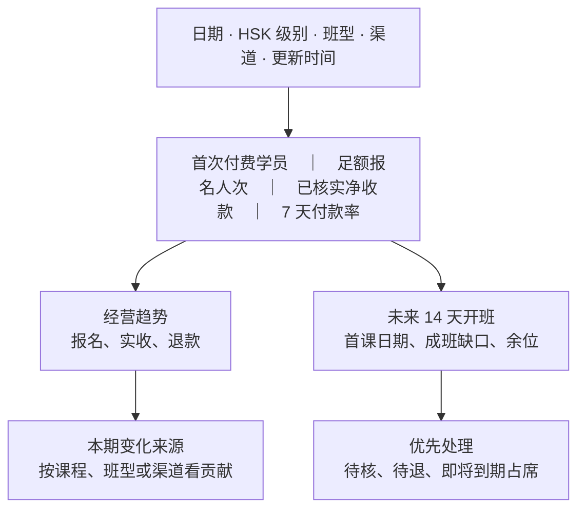

# UPER 中文课程经营看板需求

**v0.15 · 本地预览 · 2026-11-25**

读者 **管理层、招生运营、市场、销售、财务、教务和交付团队**

经营看板覆盖从获客、咨询、报名、收款到开班、交付和续读的中文课程业务。管理层应能用它安排投放和班次，职能团队应能定位问题并到现有工作区处理。首版覆盖内部数据可核对的经营结果。广告实花、正式课程出勤和教师成本按接入进度逐步补充。

[目标与边界](#scope) · [首页和子页](#views) · [动态呈现与交互](#visual-design) · [指标口径](#metrics) · [数据与权限](#data) · [交付与验收](#acceptance) · [评审与持续维护](#decisions)

<a name="scope"></a>

## 1. 目标与边界

| 使用者 | 要做的决定 | 看板应提供的证据 |
| --- | --- | --- |
| 管理层 | 本月经营进度如何，资源先投入哪里 | 新付费学员、足额报名、已核实净收款、付款率、近期成班风险及变化来源 |
| 招生运营 | 哪些班要推动付款、调整招生安排或处理候补 | 近期开班日、足额人数、成班缺口、有效占席、余位、报名截止、需求分布 |
| 市场 | 哪些投放和入口值得继续投入 | 广告实花、已核验来源、同批付费转化、广告获客成本、归因覆盖及流失位置 |
| 销售主管和顾问 | 哪些咨询接下来要跟进，顾问实际推进了什么 | 待处理与已逾期的首次跟进、协助报名的进度、足额结果及自助成交 |
| 财务 | 实收、退款和未处理款项能否逐笔对上 | 独立转账、欠款、退款及退回、待核验账龄、对账差异 |
| 教务 | 哪些班出勤下滑，哪些课程有续读潜力 | 课次交付、登记覆盖、学员出勤、完课、续读及教学成本 |

- 建议在 CRM 增设一级入口「经营看板」。公司级经营数据从这里汇总。活动、客户、班次、核款等业务详情与操作沿现有工作区提供。班次、课程、学员、付款和退款各有独立统计粒度。
- 排期覆盖 HSK 普通班、小班和一对一。普通班关注成班和容量。一对一关注约课状态、首次授课、已交付和剩余课时。已保存的一对一需求进入需求分析。达到现有付费成立条件后，才进入付费指标。
- 看板以只读查询为主。日常分派、核款、报名确认、退改、通知、调整负责人和修改班次，均进入有权限的原页面操作。预测、异常判断和高亮只辅助人工决策。

<a name="views"></a>

## 2. 首页和子页

桌面端将八个主题放在左侧吸顶目录，右侧显示筛选和当前主题内容。低于 1024 px 时目录可展开，正文使用整行宽度。电视大屏排在最后，全屏时只展示大屏内容。

### 2.1 经营总览

| 阅读顺序 | 模块 | 展示与行动 |
| --- | --- | --- |
| 1 | 页头与筛选 | 一行放日期、HSK 级别、班型及适用的渠道筛选。默认本月至今，以 WIB 切日，对比上月相同已过天数。支持近 7 天、近 30 天、自定义和清除筛选。显示本期日期、对比日期，以及本页数据更新时间。 |
| 2 | 四项核心指标 | 首次付费学员、足额报名人次、已核实净收款、获席后 7 天付款率。卡片包含主值、对比变化、简短趋势和组成入口。转化率附分子和分母。首次可用日期、覆盖不足或观察期未完在指标旁提示。 |
| 3 | 经营趋势与未来开班 | 左侧查看报名、实收和退款趋势，以多个共享时间轴的小图对照金额和人数。右侧展示未来 14 天开班风险，突出离首课最近且尚有缺口的班次。 |
| 4 | 优先处理 | 以可行动的短句显示异常，如「2 笔到账待核验」「周六首课，还差 2 人成班」。每项显示事实、发生时间或账龄、处理责任范围和一个入口。采用已有任务与业务状态。 |
| 5 | 本期变化来源 | 展示对当期净收款或足额报名变化贡献最大的课程、班型或渠道。统计范围明确且分组互斥时提供贡献拆解，并保留「其他／未归因」。 |

「近期开班」和「当前待处理」基于最近一次读取的业务状态，分别标明未来 14 天窗口和状态截点。选择历史经营期间时保留这两个明确标注的当期视图。历史席位、历史待核数量和历史账龄统计须有时点记录后才能提供。

总览的足额报名、核实收款和已执行退款按相同 WIB 日轴比较。收款和退款使用同一金额尺度。选择图上的日期可打开该日的销售或收款明细；退款退回在收款页及净收款中独立计入。变化来源可按 HSK 级别、班型或订单当次来源查看，区分足额报名与净收款两种排序口径。首次获客来源仍在获客页独立比较。

总览桌面布局示意。手机将近期开班和待处理移到趋势前面。



### 2.2 主题分析

| 主题 | 页面重点 | 进入哪里处理 |
| --- | --- | --- |
| 获客与转化 | 两条入口漏斗、活动成本对比、语言与设备差异、未归因订单及未映射广告花费 | 推广活动、推广链接、来源待核实记录和对应报名列表 |
| 销售与跟进 | 待联系、已逾期、协助报名结果及自助结果。顾问比较使用同时间窗和同权限范围，显示样本量 | 客户跟进、商机和协助申请原记录 |
| 课程与班次 | 近期开班、成班缺口、目标时段需求、余位及候补。支持级别 × 时段、班型 × 时段的需求比较 | 班次详情、候补、选课需求和一对一约课 |
| 收款与退款 | 实收与退款变化、待核验和待退款账龄、欠款、逾期到款及对账差异 | 核款订单、独立转账、退款和原班次 |
| 教学与续读 | 课次登记覆盖、出勤、完成率、续读和已交付课时。已交付与计划课时分开 | 教学平台班次、课次和学员记录。未开通细节权限时停留在聚合视图 |
| 课程收益 | 按班次或 HSK 级别查看可归属的交付收入及教师直接成本，显示实际贡献与有依据的预计值 | 班次成本分解和经授权的费率、结算依据 |
| 电视大屏 | 固定为经营看板最后一个子项。16:9 全屏显示月度 KPI、今日同比上周同一时点、足额报名七日趋势、渠道成效、付款掉点、班次供需、开班风险、经营过程和待处理事项 | 电视仅显示汇总。在桌面看板查看明细 |

渠道矩阵使用本月 CRM 订单和首付数据，流量与广告实花截至最近完整 WIB 日。GA4 和 CRM 仍保留各自的统计对象和覆盖率。入口成效上排显示近 7 个完整日首次落地会话，下排显示本月 CRM 获席数和成熟订单的 7 天付款率。每日足额报名和授权的已核实净收款图按相同日期对齐，各自使用人数和金额刻度，负净额保留。广告报表的新导入记录可按已核对的来源／媒介汇总，历史未绑定来源的实花仍保留在广告报表。没有正式月目标、同会话申请事件、同批获客成本回执和已核定的首联、复购及退款率口径时，保留指标位置并标注待补。付款掉点以同一获席批次满七日的观察窗计算，已足额包含足额前无凭证的路径。班次供需并列当前候补、当前有效选课需求与未来 14 天可报名席位，数量独立。即将开班和成班缺口提示均展望未来 14 天，待核按独立转账笔数。大屏每 60 秒自动读取，取数延迟时保留上次成功的授权快照并标注，权限失效时清除旧数据。大屏使用现有员工会话与报表权限。

获客页的 CRM 数据分为「订单当次来源」和「学员首次获客来源」。订单表显示获席量及 7 天内足额付款的分子和分母。首次来源表对照本期与上期的首次付费学员数。两张表分别给出已确认外部来源的覆盖率。外部渠道、仅知官网入口、仅确认活动和来源未确认分列。电视大屏按来源与媒介汇总近期首次付费数据，保留未归因分组，并另列订单入口。

电视大屏宽屏底部按约 50%、28%、22% 依次展示入口成效、报名增减来源和当前待处理。入口内以等比例横条展示 GA4 首次落地的会话数，以表格展示 CRM 入口的本月获席、七天付款率及近七日获席。报名增减来源复用经营总览的足额报名分组，同期对照用统一的零轴和尺度，展示本期、上月同期与带正负号的变化。HSK 4、4A、4B 合并为 HSK 4，其他级别归入「其他级别」。待处理以四行清单保留待核笔数、账龄、退款笔数与金额、首次跟进逾期和一对一待约课。班次供需标题右侧标明每格顺序，表下注明未来 14 天可报名余位和候补与需求可能重叠的口径。

经营分析与大屏共用管理端语义色。已知同期增量用绿色，减量用琥珀并带正负号。琥珀也用于成班缺口、待核及已确认渠道中两个未足额分段里较大的一段。逾期用红色。零值、缺数和未定目标保持中性。图表的本期与前期仍有独立图例。

全屏优先使用 16:9 可视区，表格和开班列表按实际内容确定最小高度。供需表给级别和时段分配固定列宽，标题说明、三项数字和口径说明完整保留。开班行将首课时间和待核笔数并列，保留班次名称、成班状态、门槛、暂占及余位。纵向空间不足时由整张大屏滚动，各板块仍包含自己的完整内容。

月度 KPI 日期放在经营提示行右侧，刻度图例放在上周同期比较行右侧。大屏上部按已核实净收款、足额报名、首次付费学员、获席后 7 天付款率排序，前三项给更多横向空间。三项累计指标在月目标下显示实际值、完成度和进度条。竖线标示已生效的累计计划值，附超前、落后或符合进度的文字及对应计划日期。付款率以全部完成 7 天观察期的获席订单为分母，竖线为目标付款率，差距用百分点表示。尚无月目标时改为上月同期对照，付款率无成熟样本时显示缺数。顶部经营提示给出已确认渠道的首次付费人数，以及最早开课且未达门槛的班次缺口。

四项月度 KPI 后并列显示两项经营快照。未来 14 天成班达标显示达到该班足额人数门槛的班次与已排课班次之比，并标出仍有缺口的班次数。取消班次排除，缺少样本时显示暂无排课。当前待收学费复用财务队列的有效订单余额，按学费扣除已入账金额计算，沿用该指标的财务权限。

顶部 KPI 区以两个紧凑位置展示广告首购获客成本和首购后 90 天复购率。缺少已核对数据时用中性色的「—」和原因说明，数值待数据接入与核对。广告成本按同批可归因首付、币种和观察窗对账。复购率按已满 90 天且身份可核对的首购学员计算，后续购买须确认足额并排除同一购买的重复记录。

渠道成效矩阵只在表内已识别渠道间比较。GA4 会话、成熟获席订单 7 天付款率、首次付费人数分别在各列突出最高正值，并列同样突出。付款率保留分子、分母，广告实花用中性色显示。自然搜索与自然内容明确显示非付费，未知来源和未确认媒介采用中性色。申请启动率与广告获客成本分别在取得同会话数据和同批成本后展示。

### 2.3 用例样板

以下为演示数据，供设计走查和验收使用。

| 看到什么 | 进一步查看 | 决策或下一步 |
| --- | --- | --- |
| HSK 1 周末班两天后开课，已足额 8 人、成班门槛 10 人、暂占席 3 人 | 点「还差 2 人」，展开对应有效占席与付款状态 | 先跟进即将到期的订单，再按现有规则决定是否调整班次 |
| 获席后 7 天付款率为 60%，上期 70% | 点下降的日期或分组，查看 30/50 与 35/50、扣除未成熟订单后的同口径比较 | 判断主要变化来自忘记付款、付款过期还是资金确认延迟。原因需要订单证据 |
| 订单已足额，仍有一笔独立转账待核 | 点待核笔数，定位该笔，查看该订单已登记的其他流水 | 核对这一次来款及可能的超额，保持其他转账记录 |
| 活动广告成本下降，但未映射广告实花占比上升 | 点覆盖率，查看未映射的平台活动和受影响日期 | 补齐映射后重新比较获客成本 |
| 某班课程贡献暂不可比较，原因是 2 节代课缺费率 | 点缺失提示，查看班次、课次、负责数据来源 | 补核费率。数据齐备后刷新课程贡献 |

<a name="visual-design"></a>

## 3. 动态呈现与交互

### 3.1 选图围绕经营问题

| 要看清什么 | 默认呈现 | 用户可以怎样探索 |
| --- | --- | --- |
| 数值与变化 | 带对比值和轻量趋势线的指标卡。当前与上期用直接标签或线型区分 | 点击趋势区间后联动筛选当前分析。支持键盘选择日期和表格查看 |
| 哪一步流失 | 对齐的横向阶段条。每步显示人数或订单数、上一步转化率和流失量 | 入口切换后显示相应路径。点某步打开受权限约束的明细，按设备和语言分组比较 |
| 哪些班要行动 | 开班日历按日期排布。班次行用进度条标出已足额、成班门槛和最大容量，暂占席及余位用旁注标明 | 切为列表，按首课、缺口或等级排序。未来 14 天内的班次可直接打开原班次或待付款订单 |
| 钱怎么变动 | 同一报告日轴下用瀑布图展示实收、退款、退款退回到净收款的关系。全部金额可切换为逐项明细 | 点击各项按独立交易下钻。负值、退款退回和净额均有文字及正负号 |
| 哪些时段有供需错配 | 分面矩阵，行是 HSK 级别，列是时段。同一单元显示需求量与可供班次概况 | 点击单元同时查看真实候补和选课需求的各自构成。窄屏提供按级别排序的列表 |
| 学员何时付款或续读 | 按获席周或完课月形成的队列热图，格内直标人数或比率。观察期未完用文字和样式标记 | 展开任一格看分子、分母、观察窗和完整名单范围。筛选后保持时间轴一致 |
| 哪些活动值得加预算 | 横向效率对比条显示获客成本、首次付费数和数据覆盖，按一个明确指标排序 | 切换广告平台、活动或落地页。低样本单独标出，渠道排名使用同一观察窗口 |

获客与付款之间有两种统计粒度。会话阶段和订单阶段分别呈现，以「可关联的订单及覆盖率」解释交接。仅当所有阶段共享相同的可追溯对象、去重规则和观察窗时，才允许画成一条完整漏斗。

### 3.2 动态行为

- 点柱、日期、阶段或风险标签可交叉筛选**当前页可用的组件**。顶部显示已生效条件与清除入口。未选条件的图形保留原位置。全局条件和图表临时选择分别可清除。
- 悬停、触摸或聚焦数据点时给出名称、期间、值、对比、分母及必要的统计提示。看详情另有明确入口。重要信息在卡片摘要和表格里也能获取。
- 进入明细时继承日期、业务条件和统计范围，并显示继承条件。返回恢复页签、筛选、滚动和焦点。可分享链接携带非敏感筛选。权限在打开时由服务端重新校验。 [下钻交互参考](https://learn.microsoft.com/en-us/power-bi/guidance/report-drillthrough)
- 切换期间保留布局和排序。同一比较视图共享尺度，尺度变化时同步更新刻度。新数据到达后一次更新对应区块。选点、切换期间或筛选时可用短过渡辅助定位。页面保持静止直到有新结果或用户操作，并尊重系统「减少动态效果」。
- 对比率用百分点，金额与人数用绝对增减，适用时补相对变化。上期为零时只显示绝对变化。缺数时趋势线留断点。可直接解释的目标线须来自已确认的设置，如班次的成班门槛。
- 摘要采用可追溯的事实句，例如「净收款较上期减少 Rp 3,000,000，其中 HSK 2 净收款减少 Rp 2,000,000」。点击句子可核对数据。系统只能给出可由数据支持的变化及构成。原因归属交给有证据的业务分析。

### 3.3 可读性、响应式与无障碍

- 桌面优先显示首屏决策信息和方便比较的双列区。手机按指标、风险、趋势、明细顺序单列排版，高级条件收起，重要事项保留可点的整行入口。宽表可切为重点列或明细卡。
- 图表颜色复用管理后台语义。高亮只标记选中对象、变化方向或真实业务状态，含义同时由文字、位置或线型表达。迟到、无权限和暂无来源分别说明。
- 每张图同时提供可访问的数据表或等价文字摘要。键盘能完成筛选、选点、展开、清除和返回。聚焦提示可读，交互目标有清晰轮廓和可触区域。按 WCAG 2.2 AA 验收聚焦、对比和受控更新，另验减少动态效果。 [WCAG 2.2](https://www.w3.org/TR/WCAG22/)
- 英文和印尼文优先做版式校验，中文同步。完整 IDR 金额采用现行格式，图表空间不足时减少刻度密度，并在明细中保留精确值。普通记录时刻沿用浏览器当地时间，经营分组时区在顶部固定标注 WIB。 [金额规范](../../design/admin-money-system.md) · [日期与时间规范](../../design/admin-time-system.md) · [颜色规范](../../design/admin-color-system.md)

<a name="metrics"></a>

## 4. 指标口径

日常查阅入口为 CRM「系统文档 → 经营看板指标与统计口径」，也可从看板页头进入。该章节集中说明分母、适用日期、数据来源、覆盖与缺口，按主题保留稳定链接。 [在线指标口径](/crm?tab=docs#crm-guide-dashboard-metrics)

日期维度采用指标的业务事件日期。看板能说明一个值是「期间内新增」「同批次最终达成」还是「截至该日当前状态」。默认以 WIB 分组，跨自然日、跨月及历史回补均按相同规则计算。卡片和下钻共用筛选、时间基准与指标版本。

### 4.1 招生与销售

| 指标 | 统计对象与算法 | 时间或例外 |
| --- | --- | --- |
| 首次付费学员 | 首次足额购买中文课程的规范学员去重数。学员与付款人分开。同邮箱、手机号可对应多位学员 | 按首次足额成立时刻。身份待核实和历史覆盖不完整的学员单列 |
| 足额报名人次 | 首次达到足额的一次购买计一人次。不同课程可分别计数。转班承接同一购买保留原链路 | 按首次足额事件。后续退款进入退款与在读口径，历史成交仍可追溯 |
| 获席后 7 天付款率 | 已完整观察 7 天的获席订单中，在获席后 7 天内首次达到系统核实足额的订单占比 | 分母按获席批次。观察窗从获席时刻起连续 168 小时。过期或取消保留在分母。当前观察未完的订单显示为未成熟。到账到核实的耗时另列 |
| 付款流失与待确认 | 分列过期未达到足额、取消、付款已申报等待核验、部分实收及待补缴 | 订单未终结的暂态由业务状态判断。取消原因支持多选时同时展示答卷数和各选项计数 |
| 会话转化 | 落地访问、查看班次、开始申请或有效咨询、前往报名／请求顾问分别按可查证的会话事件去重 | 只计算已采集且定义明确的步骤。验收同会话刷新、重复事件与缺失埋点 |
| 销售协助成交与首次跟进 | 以确认关联订单的协助行为和真实销售记录判断。自助、已证实协助与未分类分开。首次跟进用实际时间和原适用规则 | 默认负责人分配用于跟进归属。历史业绩保留已记录的协助事实，现任负责人变化不追溯改记 |
| 复购与续读 | 复购为同一学员后续足额购买。建议将续读定义为同一完课批次内，在约定窗口中足额报名后续 HSK 级别的学员占比 | 完课定义、可计入的后续课程与续读窗由教务确认。未完整观察、无后续课程可售及历史身份缺失分别标明 |

漏斗优先支持广告直达 `/enrollment` 与自然咨询经 `/chat`。前者重点核对班次详情、开始申请、获席及付款。后者重点核对咨询、选班或顾问介入及报名。另提供 `/link` 分流视图。GA4 访问来源、CRM 首次获客来源、订单当次来源及销售协助分别展示。归因未知、仅知活动或正在核实的金额留在各自分组。 [推广归因设计](../../analytics/promotion-attribution-design.md) · [GA4 事件合同](../../analytics/ga4-event-contract.md)

落地页和来源分别记录。广告、自然搜索和社媒都可能进入同一个页面，以已核对的获客标签判定渠道。首接 GA4 时优先验证最近 28 个完整 WIB 日的会话总量、来源／媒介及首次浏览路径，并与 GA4 报表对账。核对 `/enrollment`、`/chat`、`/link` 和其他路径，以及直接访问和未知来源。将 GA4 数据日期和最近读取时间与 CRM 各自标注，近期窗口允许回补。未取得同批可追溯的会话与订单时，漏斗在两个数据边界分别呈现。广告活动与推广链接映射后，才可在同一归因范围计算每位新付费学员的广告成本。 [GA4 字段说明](https://developers.google.com/analytics/devguides/reporting/data/v1/api-schema) · [GA4 数据时效](https://support.google.com/analytics/answer/11198161?hl=en-CA)

已获席订单可按记录的报名入口或报名语言对比。以第一份已提交凭证和首次核实足额的时刻作依据，分别统计七天内先有凭证再足额和足额前无凭证的订单。足额后补传凭证仍保留在后者。两条付款路径加总与七天付款人数对平。观察期未满和付清时间缺失分别显示，分母仅包括观察期已满且可核对付款结果的订单。此处的报名入口记录用户如何进入办理流程，GA4 的首次落地页继续独立统计。

### 4.2 现金、投放与班次

| 指标 | 统计对象与算法 | 时间或例外 |
| --- | --- | --- |
| 已核实实收 | 每条实际收款流水只计一次。凭证申报、跨班抵扣及同笔凭证补传分别保留其业务用途 | 首版按系统记账日汇总。另提供实际到账日用于财务对账 |
| 净收款 | 已核实实收 − 已登记实际退款 ＋ 退款退回 | 三类都用对应系统记账日。银行实际日口径待全链路字段对齐后提供。显示单据构成及追溯入口 |
| 当前待收、待核、待退 | 待收用有效订单应收及已核实抵扣后的未付余额。待核按独立申报转账。待退按已批准待执行金额与净退款差额 | 已足额订单的其他待核仍计入。当前账龄以刷新时刻为截点，待核从核验队列的凭证提交时间起算，待退从退款单登记时间起算。分为不足 24 小时、24 至不足 72 小时、72 小时及以上、时间待补 |
| 广告获客成本 | 广告实花 ÷ 同一归因范围与观察窗内首次付费学员数 | 广告平台日期、币种与 UPER 归因先对齐。分母为零显示不可计算。低样本及覆盖不足可见 |
| 归因净收款回报 | 同批归因净收款 ÷ 同批广告实花。建议对比固定 30 天观察窗，需市场确认 | 标清归因规则、重复分配防护及观察窗。用实际花费衡量广告回报，课程贡献另有独立口径 |
| 开班缺口、占席与余位 | 成班缺口以班次公布门槛减符合开班条件的足额人数，下限为 0。暂占席、已足额和余位采报名服务现行规则 | 以即时状态为准。无成班门槛的一对一用预约与交付进展 |
| 课程需求 | 候补、选课需求、一对一待约各按有效记录展示，另给跨来源去重的学员范围 | 撤回或终结进入历史。不同需求可以同时属于同一学员，跨组加总须标明粒度 |

财务详情展示交易参考号、类型、登记时间、已记录的实际到账时间与关联订单。退款和退款退回目前只能按登记时间追踪。筛选和每日趋势统一按 WIB 记账日。初版以报名财务流水为公司课程现金来源。若历史 CRM 付款覆盖同一笔，须核对去重和覆盖区间后再纳入统一历史总额。 [报名收款定义](../../design/admin-record-detail-system.md#报名收款核验) · [银行证据与实收记录](../../../server/portal/enrollmentApplication.ts#L885)

### 4.3 教学、成本与收益

| 指标 | 统计对象与算法 | 时间或例外 |
| --- | --- | --- |
| 已交付课时 | 按有实授记录的有效课次汇总，保留课次数与实授分钟 | 停课、代课、补课、改期依教学记录判定。计划课表另外呈现 |
| 出勤与登记覆盖 | 出勤率以已登记、有资格应到的学员课次为分母。覆盖率以已授课中应登记的学员课次为分母 | 缺记录标为待登记。请假、旁听、补课等规则由教务确认 |
| 完课率 | 达到教务确认的完成条件学员 ÷ 同一班期进入完课判定范围的学员 | 转班、退课、未到判定日期分开。完课率和续读率使用各自基础分母 |
| 教师直接成本 | 按实际执教对象、课型、有效日期与对应计费单位，汇总已交付课次成本 | 费率变动按实际授课日期。缺费率、币种或课次无法匹配时显示成本覆盖和影响范围 |
| 课程交付贡献 | 财务确认的班次已交付可归属收入 − 已确认直接成本。预测场景另显示预计值及假设 | 报名现金、已交付收入和贡献有独立时间轴。成本范围、收入分配与可退部分由财务确认 |

<a name="data"></a>

## 5. 数据与权限

### 5.1 数据事实和连接方式

| 来源 | 当前依据 | 接入要求 |
| --- | --- | --- |
| CRM 和报名 | 已有客户、商机、推广归因、订单、班次、收款、退款和抵扣。活动分析已展示登记、测评、出席、报名和核实收退款 | 服务端基于业务事实聚合。用规范学员、订单、班次、活动与交易键关联，历史身份冲突显式待核。按事件保留首次足额与必要状态变化。 [现有活动统计](../../../src/utils/crmCampaignMetrics.ts#L5) · [报名要求](../enrollment-v1-release.md#放行验收表) |
| 广告平台和 GA4 | 用户确认广告实花可从广告平台 API 获取，目前无现成报表。GA4 有访问和部分行为事件 | 按平台账户、活动、组、广告 ID 和日期同步。映射到 UPER 活动或推广链接。保留币种和平台日期边界，展示回补与映射覆盖。 [Meta Ads Insights](https://developers.facebook.com/docs/marketing-api/insights/v9.0) · [GA4 数据时效](https://support.google.com/analytics/answer/11198161?hl=en-CA) |
| 教学管理平台 | 用户确认正式课程的出勤在教学平台。现有 CRM 出席记录以营销活动为粒度 | 教学平台提供课次、教师、实授时间、学员和出勤。优先使用稳定班次与学员 ID。确认有 API 或经批准的结构化导出。 [现有活动出席](../../../server/portal/attendance.ts#L49) |
| 教师费率 | 用户确认可在教学平台或 CRM 中维护，目前无现成表格 | 选一个费率主来源，以实际课次为计算依据。费率按教师、课型、生效日期及计费单位维护，历史费用与当时费率可追溯 |
| BCA | 自动流水或 VA 接入尚待 BCA 反馈和另案验收 | 以现有核款流水先交付。银行来源接入后用于补充实际发生时间、对账状态和来源；同一笔付款维持统一事实 |

### 5.2 时效、完整性与性能

- 每个主题显示数据截至时间，区分可信零值、无匹配记录、缺字段、来源尚未开通、同步延迟和权限受限。迟到或回补记录更新对应期间，重复导入保持相同结果。数据状态可打开查看受影响期间、可用覆盖和负责来源。
- 看板首屏读取服务端授权后的汇总。图表明细按需分页，日期、课程、渠道等高频条件使用可控范围的聚合。外部 API 在后台同步。同步失败时保留最后成功的授权数据和更新时间。快速切换筛选时，旧请求结果不能覆盖当前页面。
- 首版只读取范围内的结构化字段。支付凭证、咨询全文、邮箱、手机号及个人教师费率按现有授权在明细工作区查看。图表查询、跨图联动、直接下钻和后续导出分别经过服务端校验。权限撤回后清除已失权的页面数据。
- 生产经营数据与本地、测试、演示数据隔离。排除已标记的测试记录，记录无法识别的范围。外部导入的字段范围、凭证和实际联调另行确认。业务写操作沿用原权限，新增环境变量遵循项目审批规则。 [项目维护规范](../../../AGENTS.md)

### 5.3 建议的查看范围

| 角色 | 默认呈现 | 原记录权限 |
| --- | --- | --- |
| 管理层 | 经批准的全公司汇总、目标对比和异常趋势 | 客户、收退款与教师费率明细分别授权 |
| 招生运营 | 所负责范围的招生、班次、开班、候补和待办 | 可进入有权读取的班次、订单及客户记录 |
| 市场 | 投放成本、匿名会话和授权范围内的活动归因与成交汇总 | 按权限查看活动及来源核实。学员联系方式和付款凭证按原授权查看 |
| 顾问和销售主管 | 自己或获准团队的跟进、协助报名与相关业务数据 | 延续客户范围和主管权限。合计、排名、下钻及共享链接均套用相同范围 |
| 财务和教务 | 财务查看获准范围内的现金与核验，教务查看获准课程及课堂统计 | 教师费率、财务流水与学员教学记录分别校验。导出能力需明确授权后接入 |

### 5.4 数据可用性核对

| 指标或来源 | 当前依据 | 缺口与取得方式 |
| --- | --- | --- |
| 席位、班次、候补及约课 | 报名订单、班次名单、候补和选课需求可查询。成班和占席沿用原工作区的规则 | 需要历史时点对比时增加每日席位快照。用普通班和一对一样本核对状态解释 |
| 足额时间、首次付费和历史覆盖 | 当前可追溯的足额事实使用付款确认事务留下的回执时间，不以邮件发送成功为成立条件。身份匹配复用 CRM 规范客户关系 | 没有足额回执的旧订单无法可靠还原足额日期。先用脱敏样本核对覆盖。若业务要求完整历史，依据财务确认的旧事件补录，未来可记录独立的不可变足额事件 |
| 商机协助与首次跟进 | 有确认后的协助申请以及首次联系任务。看板按已记录方式计数 | 旧订单缺少协助或办理证据时留在未知组。顾问归属和跨阶段归功另需运营确认 |
| 实收、退款退回、银行实际日 | 报名逐笔交易和退回记录可按系统记账日汇总。登记的到账时间可用于收款明细核对 | 退款和退回缺统一银行实际发生日。BCA 流水与 VA 的可用性待银行答复；开通后用流水逐笔对账，并与已有核款记录去重 |
| 订单来源与学员首次获客 | 订单有推广来源快照，CRM 保存可核验的首次获客来源 | 先核对投放链接、活动编号和未归因订单，确认映射覆盖。未知来源不分摊给已知渠道 |
| GA4 会话、落地页和设备／语言漏斗 | 看板支持校验后的「来源／媒介 × 首次落地页」和「设备 × 首次落地页」。CRM 可以按已记录的报名语言分组 | 正式属性待授权读取和对账。站内界面语言、咨询和申请的会话漏斗需确认采集覆盖和顺序。会话到订单的同批匹配须核对可关联键及授权范围。 [UPER GA4 三环境](../../analytics/ga4-environments.md) · [GA4 字段说明](https://developers.google.com/analytics/devguides/reporting/data/v1/api-schema) |
| 广告实花、每位新付费学员广告成本 | 已支持导入按账户日与活动汇总的广告实花。看板按币种显示实花、已映射和未映射金额 | 市场提供实际账户和样例导出。按同一批新增学员、可确认的首次获客及约定付款观察窗对账后再计算获客成本 |
| 出勤、完课、续读 | 已支持按报名班次或已确认一对一约课导入实授课次及出勤汇总。完成条件及续读观察窗待教务确认 | 教务提供一个普通班和一个一对一样本，包含完整日期、稳定课次 ID、实授分钟及应到／已登记／出勤数。CRM 营销活动出席另有用途。完课及续读需再对齐学员键和观察窗 |
| 教师成本、班次贡献 | 看板可读取已核定教师成本和可归属收入，逐班显示成本核定覆盖。日期、成本和收入都完整时计算贡献 | 选定教学平台或 CRM 作为唯一费率源，保存生效日期和计费单位。由财务确认已交付收入、退款和全部直接成本的分配，并提供核对样本 |

### 5.5 首次同步 GA4 流量

1. 由 GA4 负责人给授权读取身份开通目标属性报表权限及 `analytics.readonly`，使用已有 Google 授权流程取得短时 OAuth 访问令牌。选择 UPER 正式属性的公开数据流，或各自的本地／测试数据流。令牌由标准输入传给命令。报名收退款上报继续使用现有 Measurement Protocol 配置。 [Google Data API 授权说明](https://developers.google.com/analytics/devguides/reporting/data/v1/quickstart)
2. 先预览并核对同一数据流、相同日期和筛选条件的 GA4 报表。以下示例从已配置相应范围的 Google 本地授权会话取令牌，只读正式报表，默认查询最近 28 个完整 WIB 日。

   ```sh
   gcloud auth application-default print-access-token | node --import tsx scripts/sync-dashboard-traffic.mts --environment prod
   ```

3. 核对无误后，由有权访问该环境的运维在对应环境重复同一命令并显式加 `--apply`。同次写入按事务提交。相同日期以较新的读取结果覆盖，已有快照在报表分页不全、时区不符、取数受限或按日对不平时保留。需要回补时指定 `--from` 与 `--to`，单次最多 93 个完整日期。数据库保存按日汇总，暂无自动同步。 [GA4 返回结果说明](https://developers.google.com/analytics/devguides/reporting/data/v1/rest/v1beta/ResponseMetaData)

报表使用带部署环境、客户流量分类的 `page_view` 与 `sessions` 口径。按配置选择数据流，排除模拟验证事件。GA4 属性报表时区须核对为 `Asia/Jakarta`。源数据只有首个浏览页，按 `/enrollment`、`/chat`、`/link`、其他页面、页面未知分组，URL 参数和其他路径不进入存储。看板显示请求日期、已覆盖天数及该批数据最早同步时间。CRM 级别和班型筛选仅约束报名和成交指标。

设备报表以 `deviceCategory` 归并手机、电脑、平板、其他和未知。同步逐日核对每个落地页的来源分组与设备分组会话数。旧快照可继续展示已有会话，设备覆盖从首次成功同步起计。GA4 设备语言与发生报名时的界面语言各自保留原口径。

若要取得**同会话顺序漏斗**，由 GA4 负责人确认是否已有正式属性的 BigQuery 事件导出。先在授权的分析工作区内按数据流、用户伪标识和会话 ID 分组，按实际事件时刻核对首个落地、咨询消息保存、顾问请求和可验证的申请步骤。只把日汇总带入看板，保留缺会话 ID、漏报及未验证阶段的覆盖说明。设备用会话的首次落地事件取得。界面语言以应用实际语言标记验证后采用。GA4 的内置漏斗可供核对，按用户计数的界面和本项目会话指标需分别标注。 [GA4 BigQuery 事件字段](https://support.google.com/analytics/answer/7029846) · [GA4 Funnel Data API 口径](https://developers.google.com/analytics/devguides/reporting/data/v1/funnels)

### 5.6 首次导入广告实花

由市场从广告平台以同一过滤条件取得两个报表。一个按账户和日期统计 `spend`，用于对账。另一个按活动和日期统计 `spend`，用于活动归因。保留账户 ID、活动 ID、币种、日期和账户时区。对于 TikTok，使用同一 `spend` 指标贯通两个粒度。广告券、实际结算额和银行扣款各有独立用途。首版导入完整 WIB 日。非 WIB 账户需取得小时粒度数据，换算并复核后再按 WIB 日汇总。 [Meta Ads Insights](https://developers.facebook.com/docs/marketing-api/insights/) · [TikTok 广告报表](https://business-api.tiktok.com/portal/docs/run-a-synchronous-report/v2.0)

每份文件包含一个账户、一个币种，最多 93 个连续日期。无实花的日期显式提供账户总额 `"0"` 和空活动数组。金额以十进制字符串保存，最多四位小数。用真实导出日期填写 `extractedAt`。可选映射只维护已核对的「平台活动 ID → UPER 付费推广编号」。首次样例应同时含已映射和未映射活动。

以下是一个模拟报表，金额单位为 IDR。

```json
{
  "version": 1,
  "environment": "dev",
  "platform": "meta",
  "accountId": "123456",
  "metric": "spend",
  "currency": "IDR",
  "timeZone": "Asia/Jakarta",
  "from": "2026-11-23",
  "to": "2026-11-23",
  "extractedAt": "2026-11-25T01:00:00.000Z",
  "days": [
    {
      "date": "2026-11-23",
      "total": "1250000",
      "campaigns": [
        { "campaignId": "101", "name": "HSK 1", "spend": "900000" },
        { "campaignId": "102", "name": "HSK 2", "spend": "350000" }
      ]
    }
  ],
  "mappings": [{ "campaignId": "101", "promotionId": "example-hsk1-paid" }]
}
```

```sh
node --import tsx scripts/import-dashboard-ad-spend.mts --environment dev --file /path/to/ad-spend.json
```

预览核对账户总额、日期和未提供映射的金额。由有权运维在对应环境显式加 `--apply` 时，系统核对映射确实指向当前该环境的付费推广链接，再按事务写入。示例推广编号须替换为该环境核实过的实际编号。更新同一账户和日期时，提供导出时间较新的完整一日数据。看板仅向具有全量 CRM 及活动管理权限的员工显示实花，并列出实际导入账户及日期覆盖。缺少账户或日期会使报表低估全量投入。

### 5.7 首次导入实授、出勤和已核定成本

先由教务选一个普通班和一个已确认的一对一约课。对照教学平台稳定班次或预约编号，绑定到本系统报名班次 ID（`class`）或已确认的一对一选课需求 ID（`appointment`）。核对授课日期、补课与代课合并口径，以及哪些学员应到、哪些已登记、哪些实际出勤。课次 ID 用教学平台的稳定编号，不导入个人姓名、学员联系人或教师费率明细。

每份文件对应一个绑定和最多 93 个完整 WIB 日期。确认无课时提供空数组。已授但名册未知的课次以 `attendance: null` 标注，覆盖率用有名册的应到数作为分母。授课范围变动时，用时间较新的完整文件同时更正原日期和新日期。班次和日期作为汇总替换粒度。

```json
{
  "version": 1,
  "environment": "dev",
  "timeZone": "Asia/Jakarta",
  "binding": {"kind": "class", "referenceId": "example-class-id"},
  "extractedAt": "2026-11-25T01:00:00.000Z",
  "from": "2026-11-23",
  "to": "2026-11-24",
  "days": [
    {
      "date": "2026-11-23",
      "lessons": [{"id": "example-lesson-id", "minutes": 45, "attendance": {"expected": 10, "recorded": 8, "present": 7}}],
      "finance": {"currency": "IDR", "costedLessons": 1, "teacherCost": 100000, "revenue": 300000, "directCost": 120000}
    },
    {"date": "2026-11-24", "lessons": []}
  ]
}
```

```sh
node --import tsx scripts/import-dashboard-teaching.mts --environment dev --file /path/to/teaching-report.json
```

默认预览课次和分钟汇总。经相应环境授权后加 `--apply`，验证绑定并在一个事务内写入。教务确认的完整一日可独立提供。若财务金额已存在，更新这一天的合并报表时带上经财务重新核对的金额。金额单位为整印尼盾，教师成本和直接成本应由采用生效费率的财务来源确认。可归属收入沿财务批准的课次确认规则，允许带负数的退款调整，并按该分配归回对应交付日。未核定的金额使用 `null`。贡献需已覆盖所选全部日期、每节实授课次有核定成本、且收入及全部直接成本已确认。需要外币时由财务先确定币种和归集规则。

教务汇总沿用全量 CRM 与报名运营权限。课程收益同时要求全量收款核验权限。看板按班次汇总，教师个人费率和单个学员记录仍由各自来源及权限管理。

### 5.8 大屏月度目标读取

大屏从现有 `portal_settings` 按 `dashboard_monthly_kpi_v1:<环境>:<WIB 年月>` 读取获批计划。`targets` 中 `first` 和 `paid` 分别为首次付费人数及足额报名人次，`net` 为整印尼盾净收款，三项月目标均为正整数。`paymentRate` 使用 0 至 1 的比例。`milestones` 按 WIB 的 `YYYY-MM-DD` 收纳累计计划，每项取截至当天最近一个有效日期。暂缺累计计划时，仅显示已确认的月目标和完成度。净收款计划随财务权限限制读取。实际目标由经营团队确认。

经经营团队确认后，使用 `scripts/import-dashboard-kpi.mts` 预览月目标。输入包含 `version: 1`、`environment`、`month`、`approvedAt`（含毫秒的 UTC ISO 时间戳）、`targets` 和可选的 `milestones`。一份文件代表该环境该月完整的已批准版本。先核对预览，再在获准的环境加 `--apply`。重复应用同一内容无变化，较旧或同时间不同内容的版本被拒绝。说明文档中的数字、验收样本和配置示例均不作为正式目标。

```sh
node --import tsx scripts/import-dashboard-kpi.mts --environment dev --file /path/to/approved-plan.json
```

### 5.9 供需、渠道与历史覆盖

课程与班次专题与大屏共用候补、待匹配普通班需求和可报名余位的聚合。专题另列包含关闭报名班次的物理余位，并把一对一单列。大屏 7 天付款率的领先色仅用于拥有至少 20 笔成熟获席订单的已识别渠道。低于门槛仍可查看实测值和分母。GA4 会话的领先色需要所选期间完整的流量快照。

获客专题与电视大屏将精确路径 `/` 单列为官网首页。旧快照保持原统计，首页仍在原「其他」计数内。当期无重新分类日时首页显示「—」。混合期间显示首页可计算值及覆盖日数，及时重读经授权的完整日期可重建可比较系列。

<a name="acceptance"></a>

## 6. 交付与验收

| 批次 | 交付 | 可检查的结果 |
| --- | --- | --- |
| 口径与原型 | 用两个样板班完成数据对照、总览和下钻原型。一个班仍在招生，一个班已结束招生 | 财务能逐笔对金额，运营可解释成班缺口，市场可识别不同漏斗分母。记录历史可追溯起点 |
| 首版 · 内部经营 | 总览、开班风险、收款与退款、获席到付款、销售跟进概况，以及能对应原工作区的下钻 | 同一范围内指标与明细对平。管理人员能用样板在一分钟内找出优先干预的三个班。财务可追到异常款所属转账 |
| 增长分析 | 主要广告平台成本、推广映射、两条流量漏斗、同批归因转化和广告获客成本 | 花费与平台报表一致。归因差异能追溯到映射、时间窗或数据覆盖。对比明确区分自助、协助和未知 |
| 教学与课程收益 | 正式课程的出勤、完课、续读、教师直接成本与班次贡献 | 普通班及一对一的实际课次与课堂记录一致。验证代课、补课、调价、退改和缺失状态 |

### 当前验收证据与边界

本地 3000 已加载 `42445b6a9706-a5ba74170641d111` 工作区预览。前后端构建号一致，健康检查及 worker 正常，沿用原数据库和环境配置。25 个迁移 SQL 文件与回退版本 `42445b6a9706-df8d236258957a69` 逐个一致。

上一预览版本使用现有本地数据库，每种筛选预热后重复只读取数 20 次。总览使用 8 条查询，p95 为 9 毫秒。近 30 天的 HSK 1 获客使用 10 条查询，p95 为 2 毫秒。此处记录数据库读取及服务端汇总的本机样本，浏览器表现及生产数据规模仍需独立验证。

| 范围 | 已核对 | 待取得的依据 |
| --- | --- | --- |
| 总览、班次、销售、收款 | 用本地数据只读核对日趋势、HSK／班型／渠道分组、收退款与净额。本期有 3 笔登记流水，待核和待退队列为空。用中文桌面模拟数据核对按日下钻、筛选保留、非空账龄、登记与到账时间及权限 | 两个实际业务样板的完整逐笔对账，含活跃退款和待核款。历史成班缺口需历史时点记录。顾问归功需可追溯协助记录 |
| 获客与广告实花 | 模拟数据核对落地会话、设备、分币种实花和日期覆盖。本地只读核对两条七天付款路径与订单汇总 | 正式 GA4 只读报表与广告账户日报。界面语言和同会话漏斗待验证采集。获客成本需对齐同批学员和付款观察窗 |
| 教务与课程收益 | 模拟数据核对普通班、一对一、登记缺口和已核定成本，检查财务字段的权限投影 | 教务课次与名册样本、完课和续读定义、费率及财务批准的收入／成本分配 |
| 电视大屏 | Chrome 中文桌面模拟 2K、4K 全屏，核对 KPI 顺序、计划刻度、同期对照、渠道配色、供需标题说明和底部三栏。报名增减覆盖正数、负数、持平、合并 HSK 4A／4B、其他级别及空状态。核对权限拒绝、刷新失败时保留上次快照和权限失效时清除数据。本地只读核对七日区间、渠道分段、逐笔待核权限及数据覆盖。当前本地库尚无月度目标及广告实花快照 | 正式月目标、广告同批归因及复购观察样本，目标电视上的可读性、常驻会话及正式报告刷新 |

### 验收场景

- [ ] **经营任务**。管理人员能从首屏判断当期变化、未来 14 天最紧急班次和下一步。营销能从渠道异常下钻到推广活动。财务能从净额拆解回到对应核款、退款或退回。
- [ ] **业务与账务**。同邮箱多学员、同学员复购、重复凭证、分笔支付、同额来款、转班抵扣、退款退回、逾期后补录和状态变动均有样板。公司总额、维度分组和授权明细可对照。对账有差额时逐项说明。
- [ ] **统计**。覆盖零分母、未知来源、未成熟批次、部分数据、比较期长短不同、WIB 跨日、历史回补和重复导入。对比差值、单位、日期和筛选继承可从界面直接核对。
- [ ] **交互与无障碍**。完成点击及键盘下钻和返回、缩短时间窗、清空跨图筛选、窄屏替代视图、减少动态效果及图表表格切换。色彩、图例和三语文字符合共享设计。实际三语与窄屏验证按授权执行。
- [ ] **性能与韧性**。记录首个可作判断的页面状态、筛选反馈的 p95 和下钻耗时。比较内部缓存命中和初次查询。外部源断开时保留可用主题，过期数据及时标注。用样板测出基线后确定本期性能门槛。
- [ ] **权限与环境**。用不同权限账号验证聚合值、详情和直接访问。销售、市场、教务和财务的数据范围与原工作区授权一致。演示与测试记录不进入生产统计。

<a name="decisions"></a>

## 7. 待确认与持续维护

| 待确认 | 建议决策人 | 下次评审需要的依据 |
| --- | --- | --- |
| 首版核心指标及目标，是否采用 7 天付款窗、14 天开班窗 | 管理层、招生运营 | 两个样板班及近一个招生周期的付款时长和开班安排 |
| 历史收款和退款覆盖，有无需要并入的旧 CRM 业务数据 | 财务、产品 | 脱敏逐笔样本、可核对日期范围、旧账与报名流水的映射 |
| 第一批广告平台、账户范围、授权方式与归因观察窗 | 市场 | 现用平台清单、样本报表、推广链接映射、币种和账户时区 |
| 教学平台名称、接口或导出能力、班次与学员键 | 教务、技术 | 一个普通班和一个一对一的脱敏课次及出勤样本 |
| 教师费率主来源、成本范围、完课与续读定义 | 教务、财务 | 教师授课与费率示例，含代课、补课、调价和低覆盖场景 |
| 哪些角色能看公司总额、订单明细、教师费率及导出 | 管理层、财务 | 按岗位和数据范围的访问矩阵 |

以本文作为需求和决策的唯一维护入口。每次原型走查、数据核对和上线验收后，在对应章节更新结论，并在下方记录日期、影响、确认角色与证据。若指标口径改变，保留生效日期、旧口径与差异说明。先确定历史是否可重算，再调整趋势与对比展示。

指标增加前，用两个问题筛选。该指标会改变团队的哪项决定？用户看到异常后能点到哪份依据或进入哪一步处理？重复指标合并，无法提供可靠数据的需求保留在当前章节的待确认项。

| 日期 | 版本 | 更新和依据 |
| --- | --- | --- |
| 2026-11-25 | v0.1 | 整理全业务范围、指标与分期、确认已知外部数据来源、补齐动态呈现和验收场景。待样板、数据接入及权限评审 |
| 2026-11-25 | v0.2 | 补充末项电视大屏和逐项数据缺口。实现和验证以当前代码与验收结果为准 |
| 2026-11-25 | v0.3 | 加入账户日报导入、课次和成本读取、经营总览的按日下钻及变化分组。完成本地预览切换，记录实际取数和模拟验收边界 |
| 2026-11-25 | v0.4 | 加入设备与落地页的会话对账，以及按报名入口和语言对比的获席后付款路径。本地 3000 预览已更新 |
| 2026-11-25 | v0.5 | 增加当前待核和待退账龄、逐笔交易参考号及实际到账时间。完成本地 3000 切换和中文桌面、2K／4K 模拟复验 |
| 2026-11-25 | v0.6 | 经营主题改用左侧目录。模拟数据验证中文桌面吸顶、键盘切换、直达、刷新、返回及 2K／4K 全屏 |
| 2026-11-25 | v0.7 | 更新大屏的渠道和付款分段、班次供需、人数与金额趋势、入口成效及待处理。已加载至本地 3000 |
| 2026-11-25 | v0.8 | 入口成效与当前待处理在大屏并排。经营分析和大屏共用增减与状态颜色。已验收中文桌面浅深色及模拟 2K／4K 全屏 |
| 2026-11-25 | v0.9 | 入口成效改用 GA4 横条图和 CRM 表格。用模拟数据核对横条比例、其他入口汇总、GA4 缺数提示及 2K／4K 全屏 |
| 2026-11-25 | v0.10 | 大屏上部恢复四栏 KPI、计划刻度和进度差距；无目标时显示同期对照。保留渠道、入口、趋势和待处理板块 |
| 2026-11-25 | v0.11 | 增加未来 7 天成班达标和当前待收学费，按渠道列突出领先值。用模拟数据核对缺数、未确认渠道、财务权限及 2K／4K 全屏 |
| 2026-11-25 | v0.12 | 按经营优先级重排六项指标，底部新增报名增减来源并收紧待处理。班次供需在标题右侧注明三项数字的顺序 |
| 2026-11-25 | v0.13 | 顶部增至八项指标。广告首购获客成本和首购后 90 天复购率在顶部右侧显示具体缺数原因 |
| 2026-11-25 | v0.14 | 调整表格列宽、行距和板块高度分配，保留现有内容。用六个供需级别和三条开班记录复验中文桌面 1080p、2K、4K 全屏及低高度滚动 |
| 2026-11-25 | v0.15 | 成班达标、即将开班、成班缺口统一采用未来 14 天。KPI 日期移到经营提示行右侧。用第 9 天的模拟班次验证，并检查 1280 px 中文桌面及三种全屏分辨率 |
